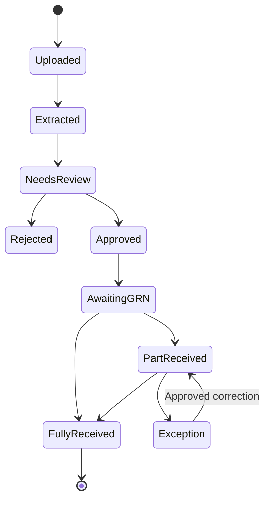
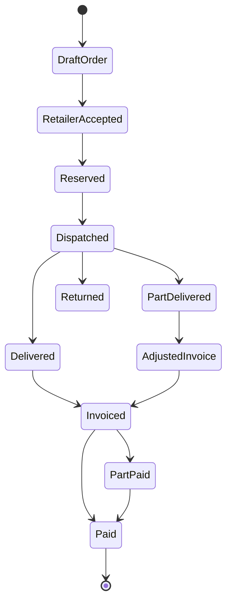
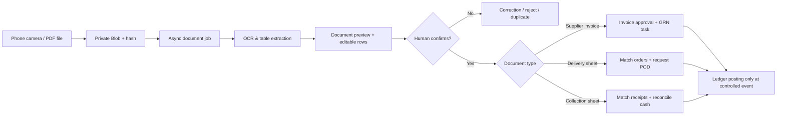
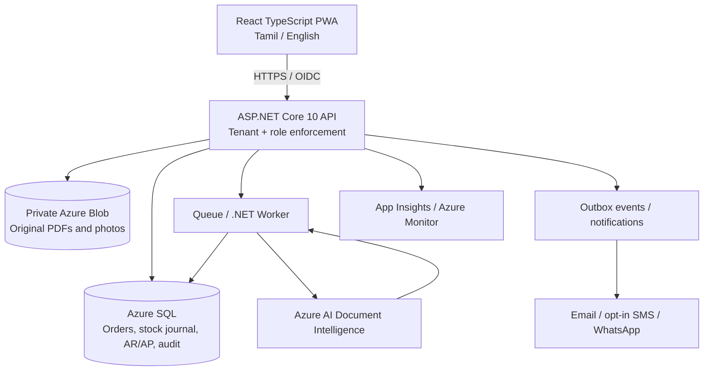

# BADRI TRADEFLOW
## Complete Software Requirements, Technology Architecture and Development Guide

> **Project:** Badri TradeFlow — District Distribution Operating System  
> **Primary users:** FMCG, grocery, personal-care and general-trade distributors in Dharmapuri and nearby Tamil Nadu districts  
> **Edition:** Architecture and engineering blueprint v1.1, 21 November 2026  
> **Reference inputs:** Seven real-world delivery, retailer-collection and GST purchase-invoice images; the role-based end-user sign-off PDF and three added PDF-upload journeys; the tested local FastAPI prototype.  
> **Implementation status:** This is a target specification. The existing prototype does **not** implement every function listed here.  
> **Data safety:** All example values in this document are demonstrations, not independently confirmed live trading balances. Never commit actual GST invoices, customer phone numbers, bank details or personally identifiable data to Git.

---

## 1. Executive decision

**Use C# / .NET 10 LTS as the main production backend language.** Prefer a **modular monolith** with strict business-domain boundaries over early microservices. Use **React + TypeScript** for the responsive web/mobile-first Progressive Web App (PWA). Use **Azure SQL or Azure Database for PostgreSQL** as the primary financial/stock transactional database, and **Azure Blob Storage** for source PDF and photo files. Use **Azure AI Document Intelligence** for extraction assistance plus a mandatory **human review stage**.

For the previously discussed Azure **Cosmos DB** preference: Cosmos DB can be used for document/state projections, tenant catalogs, or a purposely designed event/aggregate model; it should **not be selected automatically** as the only stock and accounting system. Standard Cosmos transactional batches are atomic **only within a logical partition**; cross-aggregate inventory and accounts workflows need careful consistency design. Microsoft has newer distributed-transaction capabilities which must be separately evaluated and load-tested before being assumed suitable. The lower-risk MVP is relational SQL for AR/AP and stock journals.

| Layer | Recommended software | Why this fits |
|---|---|---|
| Core application | **C# 14 / ASP.NET Core 10 Web API** | Mature business validation, strongly typed money/quantity operations, Azure tooling, long-term support |
| Web / mobile browser | **React + TypeScript + Vite PWA** | Lightweight Tamil/English responsive screens, shared code for desktop/Android browser, offline-ready architecture |
| PDF/scan processing | **.NET worker + Azure AI Document Intelligence** | Invoice OCR and generic layout/table parsing through official .NET SDK; review uncertain handwritten fields |
| Primary data store | **Azure SQL** (preferred) or PostgreSQL | Multi-table transactions, reporting, auditing, stock and accounts consistency |
| Documents | **Azure Blob Storage** | Immutable originals, version history, controlled download, scanned image/PDF storage |
| Background jobs | **Azure Storage Queue** initially; **Service Bus** if warranted | Async scanning, retries, safe backpressure; avoid overengineering for 1,000 records/month |
| Hosting | **Azure Container Apps** or Azure App Service; frontend Static Web Apps | Managed infrastructure and scaling without VM maintenance |
| Auth | **OIDC / Microsoft Entra External ID or equivalent** | Separate trader/employee identities, no tenant selection from browser as a security control |
| Telemetry | **Application Insights + Azure Monitor** | Error trends, job failures, owner audit logs and support diagnosis |
| Build / deploy | **GitHub Actions + Bicep** | Repeatable CI, testing and PaaS infrastructure deployment |
| Testing | **xUnit + FluentAssertions + Playwright + API contract/integration tests** | Business ledger reliability and easy-to-use role journeys |
| Optional ML utilities | Python only if experiments/custom-model training justify it | No need for a second backend language for normal OCR orchestration |

### .NET version guidance (verified 21 Nov 2026)

- **.NET 10 is the LTS option** (supported into November 2028) and is the recommended baseline for this new product.
- **.NET 11 exists as a short-term-support (STS) release** as of November 2026; prefer the stable LTS version for a small SaaS team.
- **.NET 8 reached the end of support on 10 November 2026.** The separate existing `document-upload-processing` GitHub repository describes a .NET 8 Azure Functions backend: upgrade that code path before adopting it as a production dependency.
- Use **`decimal` in C# and fixed-precision SQL `decimal(p,s)`** for INR, discounts and taxes; do **not** use floating-point money or rely on OCR totals for posted amounts.

### Language comparison

| Criteria | .NET / C# | Node.js / TypeScript | Python / FastAPI |
|---|---|---|---|
| Financial and inventory workflows | **Excellent fit** | Good with strict conventions | Good, requires numeric/typing discipline |
| Azure integration and SDKs | **Strong** | Strong | Strong |
| Single-language frontend/backend | No | **Yes** | No |
| Team structure for long-lived SaaS | **Strongly recommended** | Good alternative | Best as OCR/ML specialist or lean demo |
| Recommendation for Badri TradeFlow | **Primary production backend** | Frontend language | Retain old prototype as reference; optional specialist services |

---

## 2. Product scope and usability principles

### 2.1 The promise to the trader

Every morning the owner opens one dashboard and immediately sees:

1. **Stock available today / இன்று இருப்பு** — physically counted + posted stock, less reservation and unusable units.
2. **What should I buy? / என்ன வாங்க வேண்டும்?** — reorder recommendations, expected supplier lead time and carton counts.
3. **Money to collect / வர வேண்டிய பணம்** — shop/beat/salesman-wise amounts, partially paid and overdue.
4. **Money to pay / செலுத்த வேண்டிய பணம்** — supplier invoices, due dates, part payments and credits.
5. **Today's deliveries / இன்றைய டெலிவரி** — dispatched, delivered, missing items and proof.
6. **Today's cash / இன்றைய வசூல்** — recorded cash, UPI pending verification, denomination count and handover differences.

### 2.2 Usability for non-IT and lower-literacy users

- Use **Tamil + English** labels consistently, with an option for **Tamil-first** display; validate translations with actual local traders.
- Show **five or fewer primary actions per role home screen**, not an ERP sidebar of 30 menus.
- Use **large, high-contrast buttons**, readable 16–18 px body text, clear icon-plus-word combinations and low typing.
- **Colour is supportive, not the only signal**: green = verified/completed, amber = needs review, red = blocked/overdue, grey = draft, blue = information.
- Suggested theme: **saffron/orange `#F97316`** primary, **deep maroon `#641B2E`** titles, **cream `#FFF8ED`** backgrounds, **leaf green `#15803D`** verified, **warning red `#B91C1C`**, **charcoal `#27313A`** text. Keep accessible contrast; avoid bright orange body text on white.
- Every critical form uses a **three-step pattern**: `Choose → Check → Confirm`, with obvious Back and Edit.
- Support smartphone camera capture, PDF selection, compressed photo, and file progress/errors.
- Confirm results using plain language: `Payment recorded but bank confirmation pending`, not `txnStatus = PENDING`.
- Offer **print/share receipt** and do not require retailers to install an app.
- Support low network coverage: cache assigned beats/orders; queue only allowed offline operations; show **Not yet synced** clearly and prevent duplicated sync.
- No silent deletion; show what changed and who approved it.

### 2.3 Platform and domain scope

Badri TradeFlow is **one SaaS platform with multiple subscribing trader tenants**. A trader sees only their own employees, retailer/customer accounts, supplier records, stock and documents. The platform owner manages subscription and reliability, but cannot browse commercial data by default.

---

## 3. Evidence from the seven uploaded documents

| Uploaded source | Real document characteristic | Product behaviour |
|---|---|---|
| Santhosh beat-wise delivery/bill-value sheet, GK Road | Many retailers and handwritten bill values | Route/beat roster; match invoice and retailer; scan-to-draft; reconcile delivered/undelivered |
| R. Santhosh credit/debit/denomination sheet | Credits, debits, other amounts and note counts | Allocate payment and adjustments separately; verify cash count; supervisor approval |
| Vijay daily collection receipt, Bommidi | Invoice/bill numbers, shops, cash denominations | Bill-linked collection upload, partial payment, employee handover, cash reconciliation |
| PA Traders GST invoice **A000770** | Credit-bill label; 5% tax lines; promotional stock | Commercial invoice verification, supplier payable, free units, separate physical receipt |
| Himalaya Wellness purchase invoice | Batch, MFD, expiry, multiple pack sizes, scheme values; continues to page 2 | Full multipage capture, batch/expiry and unit conversion |
| Maha Enterprises invoice **ME0398** | HSN, tax rates, GST and gross/net values | GST-level verification and supplier normalization |
| Maha Enterprises detailed invoice **MHHIN009140** | Multiple SKUs, discounts, quantities/cartons, expiry | Line-level review, PO/GRN reconciliation, products/catalog mappings |

**Sample references only, not confirmed unpaid balances:** PA Traders A000770 shows **₹57,977**; Maha Enterprises ME0398 shows **₹26,059**. Do not treat these as actual supplier dues until payment/credit history is imported. The Vijay/Bommidi collection paper appears to contain a subtotal near **₹34,178** and denomination sum near **₹34,172**, suggesting **₹6 difference if they refer to the same cash set**; the handwriting and other rows require human confirmation. Never auto-post a shortfall from this scan.

The words **“entry done”** on a supplier invoice mean only that someone may have recorded it; they do not prove stock receipt, verified accounts posting or cleared payment.

---

## 4. Roles, permissions and daily screens

| Role | Home screen | Primary actions | No access to |
|---|---|---|---|
| SaaS operator | Tenant plans, onboarding, service status | Create/disable tenant, manage subscription, support with audited consent | Trader bills and bank details by default |
| Trader owner | **Daily Control Center** | Approve purchase/returns/overrides, see all AR/AP/stock, close settlement | No silent deletion of posted ledgers |
| Purchase & accounts | **Document Inbox / Accounts** | Upload, review, map, approve within policy, reconcile AR/AP, send supplier payments for approval | GRN stock acceptance unless explicitly dual-authorized |
| Warehouse employee | **Today's Receipts & Dispatches** | Count goods, GRN, batches, damage, returns, pick/pack/dispatch | Supplier bank transfers, cash settlement approval |
| Salesman/delivery | **My Beat / இன்றைய கடைகள்** | Order, dispatch handoff, POD, record collections, submit cash count | Other beats/tenants, vendor banking, stock override |
| Retailer (no-login link or optional portal) | **My Order / என் ஆர்டர்** | Accept order, acknowledge delivery, view bill, verify receipt/dispute | Other retailers' records |
| Optional supervisor | **Exceptions** | Review shortages, escalations, field approvals | Global platform tenancy administration |

**Access policy:** API must enforce a server-derived `tenantId`, user identity, branch/beat authorization and action-specific role; hiding a button on the screen is never sufficient. Two-person approval (maker/checker) should be configurable for high-value supplier payments and risky adjustments.

---

## 5. Complete functional requirements

### FR-01 — SaaS tenant, subscription and branding

- Tenant onboarding: company name, GSTIN where applicable, district, timezone Asia/Kolkata, default language, owner identity.
- Tenant-specific logo, PDF invoice footer, receipt template, contact information, currency INR and payment terms.
- Subscription: Starter / Growth / Pro, trial, seats, plan limits, invoice/OCR quota, fair-use policy, monthly or annual billing, payment status, renewal reminders.
- Suspended account: read-only/export route where contract requires; clear retention/recovery policy.
- Platform support: audited and time-bound access only after owner authorization; secure export and deletion lifecycle.

### FR-02 — Business masters

- Suppliers: GSTIN, address, contacts, default payment terms, credit days, account/bank details (safely protected), supported brands and lead time.
- Retailers: shop and owner name, mobile, beat, salesman, billing/shipping location, GSTIN optional, credit ceiling, outstanding opening balance, invoice terms.
- Beats: Dharmapuri, Bommidi, GK Road and configurable routes; staff mapping and visit frequency.
- Products: brand, product description, variants, SKU/barcode, HSN, GST tax category by effective date, MRP, sell price, purchase price, retail-unit and carton conversion, preferred supplier, reorder thresholds, scheme/free goods.
- Support retailer aliases and OCR fuzzy matching, with review before alias merge.
- Excel/CSV import with dry-run, duplicate preview and downloadable import error report.

### FR-03 — Universal Document Upload Center (**required**)

The primary home screen presents exactly three prominent document tiles: **Upload Supplier Invoice / சப்ளையர் பில்**, **Upload Delivery Sheet / டெலிவரி சீட்டு**, **Upload Collection Sheet / வசூல் சீட்டு**.

Common flow:

1. Choose type (or auto-suggest with confirmation).
2. Choose PDF, phone camera or image (PDF, JPG, PNG; configurable maximum size/page count).
3. Preview document and select additional pages; show status and estimated page count, not fabricated extraction certainty.
4. Upload directly to private Blob storage with short-lived, tenant-scoped permission; complete + checksum verification.
5. Malware/type validation and `SHA-256` deduplication; retain raw original and immutable `documentId`.
6. Queue extraction job with retry/idempotency and per-tenant processing limits.
7. Present **side-by-side source image and editable extracted rows** with flags (unclear handwriting, totals mismatch, missing bill number, GST or quantity issues).
8. Employee corrects values and explicitly confirms; supervisor handles flagged exceptions.
9. Generate **draft business records only**; do not immediately post physical stock, final customer payments or delivery completion from OCR alone.
10. Final status: `Draft → Uploaded → Processing → Review Required → Verified → Approved/Posted` or `Duplicate/Rejected/Failed` with audit.

**Do not assume the prebuilt invoice model reads Tamil handwritten collection sheets reliably.** Use the layout/read model and test against these actual forms; if handwritten results are weak, a field-by-field manual-assisted entry workflow is the MVP fallback.

### FR-04 — Supplier invoice PDF (purchase side)

- Examples: PA Traders A000770, Himalaya Wellness, Maha Enterprises ME0398 and MHHIN009140.
- Extract/review supplier GSTIN, buyer GSTIN, invoice number/date/due date, document type, HSN/SKU, quantities, cartons/pieces, free units, batch, MFD, expiry, MRP, purchase rate, discounts, SGST/CGST/IGST, taxable and grand total, IRN/QR if present.
- Check duplicate by tenant + supplier identity + invoice number and document hash.
- Match purchase order and prices if PO exists; allow unmatched supplier invoices in a controlled queue.
- Flag missing pages, tax errors, repeated line items and receipt differences.
- Commercial invoice acceptance **must not increase on-hand stock**.
- Approved invoice produces a supplier-payable candidate under the chosen accounting control and a `Pending GRN` warehouse task; prevent financial double-booking on GRN.
- Supplier dispute, debit note and cancellation workflow with full traceability.

### FR-05 — Warehouse opening balance, GRN and perpetual stock

- Opening physical count by SKU, location, batch, manufacture/expiry, paid/free units; owner signs off initial balances.
- GRN scans/counts actual accepted goods; record received vs invoiced difference, damage, shortage, free units, batch mismatch and rejected cartons.
- Posting GRN creates immutable stock-movement journal and appropriate cost valuation entries.
- `OnHandSaleable = Opening + GRN + saleable returns + approved adjustments - dispatch - damage/writeoff - transfer-out`; exclude quarantined/expired items.
- `AvailableToPromise = OnHandSaleable - Reserved`.
- Track batch/expiry, FEFO picking, products near expiry, non-sellable returns, warehouse location and physical stocktake variance.
- Allow historical correction by **compensating adjustment** with reason/approval, never by deleting posted movement.
- Count original paid/free units independently; free units still increase physical quantity but carry their appropriate cost/scheme treatment.
- Inventory valuation method (weighted average or FIFO) must be chosen with accountant and applied consistently.

### FR-06 — Smart reordering and purchasing

- Each SKU has daily demand estimate, lead-time days, safety stock, supplier MOQ, pack multiple, target cover days and inventory inbound.
- `ReorderPoint = AvgDailySales × LeadTimeDays + SafetyStock`.
- `InventoryPosition = AvailableToPromise + ConfirmedIncomingPOQty`.
- Alert if inventory position <= reorder point; show expected stockout date.
- `SuggestedBuy = max(0, TargetCoverDays × AvgDailySales + SafetyStock - InventoryPosition)`, rounded to case/carton and supplier MOQ.
- Filter poor movers, slow sales, near-expiry stock and limits of cash available before suggesting quantities.
- Owner confirms purchase order; print/email/WhatsApp export with permission. No auto-payment/auto-order to external suppliers without approval.

### FR-07 — Retailer sales, credit and invoices

- Field order capture by retailer, product, quantity, offer and price; simple number pad and recent-products shortcuts.
- Credit limit check including current unpaid orders; owner authorizes exceptions with reason.
- Invoice generation with unique tenant-defined numbering, applicable taxes, quantity, discount and credit due date.
- Track quotes/order acceptance, confirmed orders, reserved stock, picked/dispatched order and sales invoices independently.
- Partial acceptance/cancellation and GST-compliant credit-note process according to confirmed rules.
- Send order acknowledgment to retailer via opt-in channel or printed slip.

### FR-08 — Beat planning, dispatch and delivery PDF

- Plan routes for Santhosh GK Road, Vijay Bommidi and configurable beats.
- Upload handwritten/printed delivery sheet PDF; extract row number, retailer, bill no/value, beat, date, salesman and marks; manual reconciliation to existing invoices.
- Distinguish `Sheet Scanned` from `Goods Dispatched` and `Proof of Delivery Received`.
- Warehouse picks and releases stock by batch; salesman sees only his route, preferably offline.
- Retailer can accept/short-receive/reject goods; POD requires receiver name and optional OTP/signature/photo/time/geolocation with consent.
- Partial delivery, no-shop, wrong shop, damaged-in-transit, return-to-warehouse and credit-note workflow.
- End-of-day undelivered and stock-return reconciliation.

### FR-09 — Collection PDF and customer payment

- Upload Vijay/Bommidi-style collection receipt or R. Santhosh credit/debit/denomination sheet; identify salesman, beat, date, bill number, retailer and amounts.
- Differentiate credit, debit adjustment, cash receipt, electronic payment, salesperson advance and other expense. Do not combine them as undifferentiated cash.
- Match each payment to one or several specific receivable invoices; support part payments and overpayments/unallocated advance.
- Capture methods: **cash**, **UPI**, bank transfer, cheque; store reference and status.
- For cash, issue provisional receipt when salesman receives money; owner cash handover/denomination reconciliation remains separate.
- For UPI/bank, receipt status is **Pending Verification** until credible bank/payment-provider reconciliation; no confirmation solely on a screenshot.
- Auto-generate numbered retailer receipt with paid amount, remaining balance, bill(s) and payment state. Share as PDF/print/consented WhatsApp/SMS; retailer may dispute/acknowledge.
- Duplicate upload, payment reference or retry must not double-credit the invoice.

### FR-10 — Cash denomination, handover and settlement

- Count ₹500, ₹200, ₹100, ₹50, ₹20, ₹10 notes and relevant coins (denominations configurable with legal availability).
- Link expected cash to verified collected cash by employee/date/route and distinguish non-cash payments.
- Display `Expected vs Counted`, shortage/surplus and unexplained debit/expense.
- Shortage requires reason, evidence and owner approval; never silently auto-close.
- Cash stages: `Collected by salesman → Submitted to office → Owner verified → Deposited in bank`.
- Printable daily collection report with exceptions and approvals.

### FR-11 — Accounts Receivable (AR) / retailer dues

- Per-retailer: opening dues, invoices, due dates, payments, cash pending transfer, cleared UPI, credit notes, disputes, aging buckets and contact history.
- Owner view: **due today**, **overdue**, **0–7 / 8–30 / 31–60 / 60+ days**, by beat/salesman.
- `Outstanding = Posted invoices + opening debits - cleared allocated receipts - approved credit notes - approved writeoffs`, adjusted for reversals.
- Follow-up task, partial collection, promised-to-pay date, reminder/share statement, credit-hold policy.
- Never reduce retailer dues because salesman merely photographed money or uploaded a paper sheet.

### FR-12 — Accounts Payable (AP) / supplier bills to pay

- Supplier invoice ledger with bill/GRN match, due date, terms, eligible credits, disputed quantity/value and paid/unpaid state.
- `Supplier outstanding = Approved invoice liability + opening payable - cleared payments - posted supplier credits`, subject to reversals.
- View **due today/this week/overdue** and cash required for purchase orders.
- Maker/checker for supplier bank payment; record reference, approver, date and payment rail. Do not store online banking secrets.
- Support partial settlements, debit/credit notes, supplier statement reconciliation, and no duplicate-payment posting.
- The visible sample invoice amount is **invoice value**, never assume it is the current amount due without payment history.

### FR-13 — Retailer confirmation experience

- Secure, retailer-specific, short-lived, optionally one-time links for order, POD and receipt acknowledgment; no customer account required initially.
- Order confirmation, delivery quantity confirmation and payment receipt are **three distinct actions**.
- Retailer may see own invoices and due balance, raise discrepancy, download receipt, request callback, and acknowledge payment.
- All links are scoped to a specific record and expire; no cross-retailer discovery or unauthenticated invoice listing.

### FR-14 — Returns, schemes, inventory exceptions

- Sales return and purchase return, credit-note approvals, resalable/non-saleable stock, damaged packaging and expired goods.
- Vendor and retailer promotional `X + Y free`, carton/eaches conversion and scheme expiry; keep scheme stock visibility.
- Adjustment reasons and audit event required; zero or negative quantities not silently allowed.

### FR-15 — Reports and owner control

- Owner daily overview: sellable units, stock value, expiring/slow movers, reorder priority, deliveries pending, retailer dues, supplier dues, expected collections, shortfalls, clearing status.
- Retailer statement, supplier statement, salesperson beat performance, cash handover, day-wise collection register, sales & purchase registers, GST-rate summaries, product sales/returns, dead stock.
- CSV/Excel/PDF exports scoped to tenant/role; exported reports contain `As of` time and source transaction identifiers.
- Cash-in/cash-out forecast for next 7/30 days; clearly separate collection forecast from profit.

### FR-16 — Notifications and offline

- Low stock, near expiry, failed delivery, customer overdue, supplier due, pending invoice review, unapproved settlement, duplicate PDF.
- SMS/WhatsApp only with consent, sender compliance, retry/opt-out; do not claim integration is implemented until provider verification.
- Android browser PWA caches catalog, assignments and draft forms; encrypted local storage where justified; queued commands use device-generated idempotency keys and server-side conflict resolution.
- Display `Saved on phone / Not synced`, last sync and duplicate-warning states; cash collection synchronization must not create duplicate receipts.

### FR-17 — Governance, audit and support

- Immutable/auditable transitions for invoices, GRNs, stock, payments, settlement, roles and subscription changes.
- Operational support can see errors/metadata without unrestricted trader business content.
- Owner export, legal retention rules, backup/restore, support ticket, blocked-user recovery, account closure and billing history.

---

## 6. Business state machines — non-negotiable

### 6.1 Supplier invoice + goods receipt



**The `Approved` transition does not add stock. Only posted accepted GRN quantity adds stock.** A payable is posted according to the agreed accountant-approved purchase accounting policy, once only.

### 6.2 Retailer order to collection



The actual event model may differ, but **POD, invoicing, money received, verified payment, and salesman cash handover** must have distinct timestamps and audit entries.

### 6.3 PDF-to-posting pipeline (all 3 document types)



---

## 7. Recommended system architecture



### Architecture approach

1. Build **one modular .NET solution**; keep Invoice, Stock, Sales, Collections and Accounting domains separate in code and database interfaces.
2. Use domain events and an **outbox** for async notifications and derived reports; never make accounting success depend on sending WhatsApp.
3. All write endpoints accept `Idempotency-Key` for dispatch, GRN, payment and cash close; verify uniqueness with a tenant-scoped persistence constraint.
4. Use EF Core 10 migrations, relational constraints, optimistic concurrency (`rowversion`/concurrency token), and database transactions for ledger posting.
5. Background worker processes a job and persists the extraction draft once; the reviewer confirms before business posting.
6. Use read models/cached dashboard queries as volume grows; accounting journals remain the source of truth.

### Azure Cosmos DB alternative (if explicitly required)

- Start with a bounded architecture proof-of-concept before choosing Cosmos for the system of record.
- Document partition key choice, maximum logical partition usage, tenant isolation, RU consumption, query cross-partition cost and batch boundaries.
- Inventory quantities, AR/AP and payments cannot safely rely on uncoordinated multi-container writes.
- A Cosmos-only implementation needs versioned aggregates, transactional batch where applicable, an outbox, compensating transactions, invariants and formal concurrency tests.
- **Recommendation:** first build on Azure SQL and document an optional Cosmos read-model/event-stream layer only if justified by scale or integration requirements.

---

## 8. Production repository structure

```text
badri-tradeflow/
├── README.md
├── docs/
│   ├── SOFTWARE_REQUIREMENTS.md
│   ├── architecture/
│   │   ├── domain-model.md
│   │   └── adr-0001-dotnet-and-relational-ledger.md
│   ├── product/
│   │   ├── tamil-english-ux.md
│   │   └── uat-sample-scenarios.md
│   └── operations/runbook.md
├── src/
│   ├── BadriTradeFlow.slnx
│   ├── TradeFlow.Api/            # Auth, REST API, OpenAPI
│   ├── TradeFlow.Domain/         # Domain entities, invariants, value objects
│   ├── TradeFlow.Application/    # Business use cases and commands
│   ├── TradeFlow.Infrastructure/ # EF Core, Azure Blob, queues and adapters
│   ├── TradeFlow.Worker/         # Document extraction and queued jobs
│   └── TradeFlow.Contracts/      # API and integration contracts
├── web/                          # React + TypeScript + Vite PWA
│   ├── src/features/
│   │   ├── home/
│   │   ├── upload-center/
│   │   ├── purchases/
│   │   ├── stock/
│   │   ├── orders/
│   │   ├── delivery/
│   │   ├── collections/
│   │   ├── receivables/
│   │   ├── payables/
│   │   └── platform-admin/
│   └── src/i18n/{en,ta}.json
├── tests/
│   ├── TradeFlow.UnitTests/
│   ├── TradeFlow.IntegrationTests/
│   ├── TradeFlow.ContractTests/
│   └── e2e/                      # Playwright role flows
├── infra/                        # Bicep for Azure resources
├── .github/workflows/
│   ├── ci.yml
│   └── deploy-dev.yml
└── sample-data/                   # Synthetic fixtures only
```

> Existing code: the local working demonstration currently uses **Python FastAPI + SQLite + vanilla JavaScript** and offers a functional learning baseline. The connected `Muthukumar123/document-upload-processing` repository has a separate Azure document-ingestion application. Neither is a ready-to-deploy .NET 10 Badri TradeFlow SaaS. Implement the new .NET solution deliberately, reusing only vetted upload/queue patterns and porting business tests.

### Initial project commands

```bash
# Requires .NET 10 SDK
mkdir badri-tradeflow && cd badri-tradeflow
dotnet new sln -n BadriTradeFlow
dotnet new webapi -n TradeFlow.Api -o src/TradeFlow.Api -f net10.0
dotnet new classlib -n TradeFlow.Domain -o src/TradeFlow.Domain -f net10.0
dotnet new classlib -n TradeFlow.Application -o src/TradeFlow.Application -f net10.0
dotnet new classlib -n TradeFlow.Infrastructure -o src/TradeFlow.Infrastructure -f net10.0
dotnet new worker -n TradeFlow.Worker -o src/TradeFlow.Worker -f net10.0
dotnet sln BadriTradeFlow.slnx add src/TradeFlow.*/*.csproj
# The .NET 10 SDK defaults to the .slnx solution format. Verify folder paths on your machine.

# Web (Node LTS required)
npm create vite@latest web -- --template react-ts
cd web && npm install && npm run dev
```

**Coding conventions:** C# nullable enabled, validation at API and domain boundary, global error contract (`ProblemDetails`), OpenAPI, UTC timestamps saved in DB and rendered in IST for Indian users, `decimal`/exact rounding, English error codes plus Tamil/English localized messages, per-tenant data tests, no secrets in source control.

---

## 9. Data model: tables / entities

### 9.1 Core tables

| Entity | Essential fields / rules |
|---|---|
| `Tenant` | `Id`, `Name`, `GSTIN?`, `Status`, `Locale`, plan/billing IDs |
| `User`, `Membership`, `Role` | Auth subject, tenant-scoped membership, active, last login |
| `Supplier`, `Retailer`, `Beat`, `StaffBeat` | Contact and payment terms, route, credit limit, authorized employee |
| `Product`, `SkuAlias`, `PackConversion`, `TaxRateHistory` | Code, unit ratios, HSN, valid-from tax rate, MRP and schemes |
| `Document`, `DocumentPage`, `DocumentExtraction`, `DocumentIssue` | Blob key/version/hash, origin, type, extracted JSON, confidence and correction trail |
| `PurchaseOrder`, `PurchaseOrderLine` | Supplier, ordered qty, unit, cost, expected date, approval |
| `PurchaseInvoice`, `PurchaseInvoiceLine` | Invoice number/date/terms/HSN/tax/discount/paid/free/batch |
| `GRN`, `GRNLine` | Invoice/order relation, accepted/damaged/rejected/free quantities, warehouse |
| `StockBatch`, `StockMovement`, `StockReservation`, `StockCount` | Product, batch, expiry, quantity, movement type, source document, audit |
| `SalesOrder`, `SalesOrderLine`, `SalesInvoice`, `SalesInvoiceLine` | Retailer, tax, quantity, due date, lifecycle, sale price |
| `Delivery`, `DeliveryLine`, `POD`, `DeliveryException` | Beat, driver, status, receiver, evidence and shortages |
| `Collection`, `CollectionAllocation`, `CashBag`, `Denomination` | Payment mode, status, invoice allocation, cash handover |
| `AccountsReceivableEntry`, `AccountsPayableEntry` | Signed journal entries, source, posting date and reversal links |
| `SupplierPayment`, `PaymentApproval`, `CreditNote`, `Return` | Cleared status, payment refs, credited balances and stock dispositions |
| `AuditEvent`, `OutboxEvent`, `IdempotencyRecord`, `Notification` | Actor, tenant, old/new status, correlation, delivery/retry state |
| `Subscription`, `SubscriptionInvoice`, `PlanQuota` | Usage, user seats, document pages, renewal, external billing reference |

### 9.2 Important constraints

- Every business table has **`tenant_id`** and relevant compound unique indexes, e.g. `(tenant_id, supplier_id, supplier_invoice_no)` for purchase invoices.
- Do not trust tenant IDs supplied in JSON query/body; derive from authenticated membership and enforce SQL access policy.
- Prevent negative saleable available quantity unless a formal adjustment workflow is approved.
- Money has explicit currency (`INR`), inclusive/exclusive tax logic and rounded totals; tax-rate changes are effective-dated.
- `StockMovement`, `AccountsReceivableEntry`, `AccountsPayableEntry` are **append-only logical journals** with reversals and posting references.
- Original document blobs are private. Upload and every export pass tenant and ownership checks.
- Every pending external transfer (UPI/bank) has `Pending`, `Verified`, `Failed`, `Reversed`; settlement follows clearance.

### 9.3 SQL example (illustrative only)

```sql
CREATE TABLE stock_movement (
  id UNIQUEIDENTIFIER NOT NULL PRIMARY KEY,
  tenant_id UNIQUEIDENTIFIER NOT NULL,
  warehouse_id UNIQUEIDENTIFIER NOT NULL,
  product_id UNIQUEIDENTIFIER NOT NULL,
  batch_id UNIQUEIDENTIFIER NOT NULL,
  source_type NVARCHAR(40) NOT NULL,
  source_id UNIQUEIDENTIFIER NOT NULL,
  quantity_delta DECIMAL(18,3) NOT NULL,
  event_time_utc DATETIME2 NOT NULL,
  reversal_of UNIQUEIDENTIFIER NULL,
  CONSTRAINT CK_StockMovement_NonZero CHECK (quantity_delta <> 0)
);
CREATE INDEX IX_StockMovement_Tenant_Product_Batch
  ON stock_movement (tenant_id, warehouse_id, product_id, batch_id);
```

All writes must run within transaction boundaries that also update reservation and ledger documents correctly; SQL above is not a full production schema.

---

## 10. Public API outline (v1)

API root `/api/v1/`; identity required except signed retailer acknowledgment endpoints. All operations are tenant-scoped. Do **not** implement these endpoints as unauthenticated demo routes.

| Method/path | Purpose | Security notes |
|---|---|---|
| `POST /documents/uploads/initiate` | Request upload session / delegated blob upload | Auth + tenant + file quota/size/type |
| `POST /documents/{id}/complete` | Hash/version registration and enqueue | Idempotent, immutable document source |
| `GET /documents/{id}` | Extraction status + original preview token | Signed, temporary download authorization |
| `POST /documents/{id}/review` | Save corrections and reviewer acknowledgment | Owner/accounts role according to type |
| `POST /purchase-invoices/{id}/approve` | Accept commercial document | Cannot add stock |
| `POST /grns` / `POST /grns/{id}/post` | Confirm physical goods and post stock | Warehouse + approval as configured |
| `GET /inventory?warehouseId=...` | On-hand, reserved, available, expiring | Tenant and warehouse scope |
| `GET /reorder-suggestions` | Reorder calculation with explanation | Read only; no auto-buy |
| `POST /purchase-orders` | Prepare/approve supplier order | Owner role for approval |
| `POST /sales-orders` | Create retailer order | Beat/customer permissions and credit checks |
| `POST /deliveries/{id}/dispatch` | Pick/issue stock | Warehouse, idempotency |
| `POST /deliveries/{id}/acknowledge` | Record POD and shortages | Evidence/receiver, signed-link controls |
| `POST /collections` | Capture payment + invoice allocations | Amount/clearing/idempotency controls |
| `POST /collections/{id}/verify` | Verify bank/UPI settlement | Accounts role and provider evidence |
| `POST /cash-bags` / `POST /cash-bags/{id}/close` | Cash handover and denomination matching | Owner review on mismatch |
| `GET /receivables/aging` | Retailer balances and aging | Owner/accounts and assigned beat rules |
| `GET /payables/aging` | Supplier bills to pay | Owner/accounts only |
| `POST /supplier-payments` / `POST /supplier-payments/{id}/approve` | Supplier payment workflow | Maker/checker threshold |
| `GET /reports/daily-control` | Owner daily KPIs and exceptions | Owner role, as-of timestamp |
| `POST /platform/tenants` | SaaS tenant creation | Platform operator only |

**Example status payload:** `{"documentId":"doc-123","documentType":"COLLECTION_SHEET","status":"REVIEW_REQUIRED","needsManualReview":true}`. The UI must never present this as “Collection Received” until accepted and matched.

---

## 11. Azure deployment and security

### 11.1 Environments

- `local`: Docker SQL/PostgreSQL and mock OCR; no real payment.
- `dev`: low-cost Azure PaaS, synthetic company records and controllable quotas.
- `uat`: representative redacted or consented invoices, mobile devices, Tamil translations, proper role authorization.
- `prod`: custom domain/HTTPS, least privilege, managed identity, backup, monitoring and incident response.

### 11.2 Minimal production topology

```text
User Android phone / laptop
    → HTTPS + WAF/rate limiting as risk demands
    → React PWA (Static Web Apps or equivalent)
    → Authenticated .NET API (Container Apps or App Service)
    → Azure SQL / PostgreSQL (private where feasible)
    → Blob Storage (private; original invoice/POD documents)
    → Queue + .NET worker → Azure AI Document Intelligence
    → Monitoring, secrets management, audited outbound notifications
```

**Secure defaults:** OIDC, owner MFA, role checks in API, server-verified tenant scope, encrypted storage/transport, scoped delegated upload, malware validation, document type and max size, Key Vault/managed identity, rate limiting, export audit, per-tenant quotas, cross-tenant integration tests, daily backups with restore drills, least-privilege CI deployment and non-production data redaction.

**Compliance gates:** Review Indian GST invoicing and current applicable e-invoice/IRN rules with a qualified accountant or GST specialist; review applicable privacy obligations, data retention, consent for messaging, commercial licensing for payment links, and any category-specific regulations. No claim of GSTN certification should be made without it.

### 11.3 SLO and load planning (proposed targets)

| Non-functional requirement | Initial target / test |
|---|---|
| API p95 response | Target < 800 ms for standard transactional reads under agreed load; benchmark required |
| Upload UX | Visible progress and processing status; retryable on poor network |
| Core ledger postings | Exactly-once business effect using idempotency + DB transaction, even with at-least-once job delivery |
| Data safety | Daily backup + recoverability test, documented RPO/RTO before paid rollout |
| Availability | Define paid support hours and production SLO before selling |
| Supported devices | Recent Android Chrome, desktop Chrome/Edge; test low-end Android over 3G/4G |
| Accessibility | Accessible contrast, keyboard navigation and large tap targets |
| Tamil quality | Native-speaker UAT for all critical messages, invoices and receipts |

---

## 12. Development phases and exit criteria

**Estimates below are planning ranges for a small experienced team, not project commitments.** Effort depends heavily on mobile/offline scope, integrations and OCR accuracy.

| Phase | Indicative duration | Deliverable | Exit gate |
|---|---|---|---|
| **0. Product discovery** | 1–2 weeks | Final roles, screen list, 10–20 redacted real document examples, rules for stock/accounts | Owner approves journeys, Tamil terms, sample calculations |
| **1. Core foundation** | 2–3 weeks | .NET 10 solution, React app, OIDC, tenant onboarding, SQL schema, role policy, CI/CD | No cross-tenant data leaks, login/security tests |
| **2. Stock + purchases** | 3–4 weeks | Product masters, opening count, supplier invoice upload, review, GRN, batch stock, reorder | No stock before GRN; accurate stock count and supplier duplicates blocked |
| **3. Sales + delivery** | 2–3 weeks | Beats, order, invoice, dispatch, POD, delivery PDF import and returns | Retailer/customer/beat isolation; all delivery exception paths pass |
| **4. Collections + accounting** | 3–4 weeks | Collection PDF import, payment allocation, denominations, AR/AP, supplier settlement, statements | Cash mismatch control; AR/AP/stock ledger and payment replay tests pass |
| **5. Production hardening + pilot** | 3–5 weeks | Offline strategy, Tamil UAT, reports, backups, subscriptions, controlled support and onboarding | Trader UAT approval; verified recovery, monitoring and audit |

**Delivery sequence:** core local prototype → supplier invoice + physical GRN → stock dashboard/reordering → delivery/POD → collection scan/AR/AP → cash close → tenant subscription billing → production pilot. A sequential build may run roughly **14–21 weeks**, with overlap possible; this range is not a guaranteed estimate.

### Recommended team

- 1 C#/.NET full-stack engineer (backend/domain/integration)
- 1 React/TypeScript UI engineer (PWA/Tamil/UX)
- 0.5–1 QA / automation engineer (can be shared)
- Part-time solution architect/DevOps
- Part-time trader subject-matter expert + accountant/GST reviewer
- Native Tamil user tester who is not an IT professional

### Developer definition of done

- API contract and role permissions complete.
- Unit + integration + e2e happy/error path tests pass.
- PDF source and extracted values are clearly distinguishable.
- No ledger amounts can be posted twice by retry or duplicate upload.
- Tamil/English critical labels and receipts verified on Android.
- Every new ledger action has timestamp/actor/tenant/source and reversal strategy.
- Audit, alerting and restore documentation updated.
- Business owner accepts the real sample document scenario.

---

## 13. Acceptance/UAT scenarios directly inspired by your PDFs

| Scenario | What the trader does | Expected result |
|---|---|---|
| **UAT-01 PA Traders purchase invoice** | Upload invoice A000770, review ₹57,977 document | Invoice accepted; supplier liability recorded under policy; **no inventory added** until counted goods receipt |
| **UAT-02 Himalaya multipage** | Upload both pages, inspect expiry and free units | Batch/expiry/pack conversions preserved and free quantities separated; missing page warning |
| **UAT-03 Maha duplicate** | Upload ME0398 twice | Second upload warns duplicate and cannot post supplier liability/stock twice |
| **UAT-04 Santhosh beat delivery** | Upload GK Road sheet, match retailers, mark delivered | Only authorized beat records; bill matches; POD and shortages are independently confirmed |
| **UAT-05 Vijay Bommidi collection** | Upload collection sheet, correct hand-written amounts | Editable line review before posting; ₹6 suspected cash gap flagged only after confirmed scope/count |
| **UAT-06 Partial retailer payment** | Enter cash ₹500 against invoice ₹1,000 | Receipt ₹500 and remaining due ₹500; later receipt works without duplicate |
| **UAT-07 UPI screenshot** | Attach screenshot but no bank confirmation | Display `Pending Verification`, not cleared, and keep appropriate receivable/payment status |
| **UAT-08 Cash settlement** | Hand over fewer notes than expected | Settlement blocked/flagged until authorized discrepancy resolution |
| **UAT-09 Supplier part payment** | Record ₹10,000 paid against verified ₹26,059 liability | Supplier due becomes ₹16,059 assuming no other approved offsets; source invoice must first be posted |
| **UAT-10 Low-stock order** | Order quantity above available stock | Suggest reorder/partial supply, not negative inventory or silent purchase |
| **UAT-11 Return and credit** | Retailer returns damaged SKU | Credit note created; stock quarantined, not saleable until reviewed |
| **UAT-12 Two unrelated trader tenants** | User from tenant A guesses document ID from tenant B | API and Blob preview deny access; no cross-tenant totals or search leaks |
| **UAT-13 Offline delivery** | Salesman saves POD while signal is absent and later syncs | Receipt not duplicated; conflict and pending sync state visible |
| **UAT-14 Payment acknowledgment** | Retailer confirms received receipt | Receipt acknowledgment never proves cash handover or bank clearance |

### Specific reconciliation policies that require owner decision

1. Is supplier payable booked at verified invoice acceptance or only after three-way match? Capture the policy with accountant approval.
2. Is sales invoice generated at dispatch, accepted delivery or another legally permitted event? Confirm local accounting/GST treatment.
3. Are credit sales allowed above the retailer's credit limit? If yes, who overrides and at what amount?
4. Which stock valuation approach is used, and how are scheme/free goods valued?
5. How long are PDFs, photos, OTP logs and financial records retained? Confirm legal/commercial requirements.
6. Is retailer sign-off via OTP mandatory, or is name/signature/photo enough for the initial district pilot?

---

## 14. Subscription model and commercial constraints

**Previously proposed rates (not market-verified quotations):**

| Tier | Suggested monthly price | Annual prepaid | Setup | Initial target |
|---|---:|---:|---:|---|
| Starter | ₹999 | ₹9,990 | ₹2,999 | Very small trader, 2 staff |
| Growth | **₹1,999** | **₹19,990** | **₹4,999** | Most Dharmapuri distributors, 5 staff |
| Pro | ₹3,999 | ₹39,990 | ₹9,999 | Higher-volume distributor, 15 staff |

Prices exclude applicable GST, third-party messaging charges and any additional OCR pages beyond an explicit fair-use allowance. Payment terms and plans must be validated against actual Azure costs, employee support time, onboarding, maintenance and churn. Cloud expense is not simply a function of row count: always-on compute, SQL minimums, OCR pages, storage, log ingestion, outbound messages, traffic and backups may dominate cost at low volume.

**Go-to-market:** start with 1 real Badri Traders pilot, then 3–5 local distributors; measure weekly active owner/salesman, days to reconcile cash, actual scan correction rate, missing retailer bills and time saved. Do not claim “fully automated” until real handwritten sheets pass acceptance.

---

## 15. Engineering backlog (ordered)

### Must have before first paid production trader

- [ ] .NET 10 + TypeScript repositories and CI
- [ ] Tenant-scoped auth/roles and operator separation
- [ ] Product/supplier/retailer/beat setup and opening balances
- [ ] Supplier invoice PDF / photo upload with human review
- [ ] Delivery sheet PDF / photo upload with human review
- [ ] Collection sheet PDF / photo upload with human review
- [ ] Duplicate-document protection and page-level preview
- [ ] Commercial invoice approval separate from goods receipt
- [ ] Batch/free-stock/expiry movement ledger and stocktake
- [ ] Reorder suggestions and owner-created supplier POs
- [ ] Retailer order/credit checks, dispatch, POD/partial delivery
- [ ] Invoice-linked cash/UPI/transfer with partial payment and idempotency
- [ ] Daily cash denomination and discrepancy resolution
- [ ] Retailer AR aging and supplier AP aging, including part payments
- [ ] Returns, credit notes and financial/stock reversal control
- [ ] Owner dashboard, receipts and basic exports
- [ ] Tamil-first mobile usability testing and offline behaviour defined
- [ ] Monitoring, backup/restore, audit, privacy/retention and security UAT
- [ ] Subscription enforcement, onboarding and support processes

### Appropriate for later releases after pilot validation

- [ ] Automated bank reconciliation/payments integrations
- [ ] Official authorized IRP/GST integrations where applicable
- [ ] Retailer order portal, retailer consent-based WhatsApp messaging
- [ ] Barcode/thermal-print integrations
- [ ] Multi-warehouse transfers, forecasting models, supplier EDI
- [ ] Fully governed offline multi-device conflict management
- [ ] Advanced demand prediction and bulk purchase optimization

---

## 16. References and implementation caveats

- Microsoft .NET support policy: https://dotnet.microsoft.com/en-us/platform/support/policy
- .NET 8/9 end of support: https://devblogs.microsoft.com/dotnet/dotnet-8-9-end-of-support/
- ASP.NET Core and EF Core documentation: https://learn.microsoft.com/en-us/aspnet/core/ and https://learn.microsoft.com/en-us/ef/core/
- Azure AI Document Intelligence invoice model: https://learn.microsoft.com/en-us/azure/ai-services/document-intelligence/prebuilt/invoice?view=doc-intel-4.0.0
- Document Intelligence language support: https://learn.microsoft.com/en-us/azure/ai-services/document-intelligence/language-support/ocr?view=doc-intel-4.0.0
- .NET Document Intelligence SDK: https://learn.microsoft.com/en-us/dotnet/api/overview/azure/ai.documentintelligence-readme
- Cosmos DB transaction boundaries: https://learn.microsoft.com/en-us/azure/cosmos-db/transactional-batch
- Azure tenant-scoped Blob design: https://learn.microsoft.com/en-us/azure/architecture/guide/multitenant/service/blob-storage
- Azure secure delegated Blob uploads: https://learn.microsoft.com/en-us/azure/storage/blobs/storage-blob-user-delegation-sas-create-dotnet
- Source product pilot: `Badri_TradeFlow_MVP_Source.zip` (FastAPI demo) and the previously generated end-user sign-off and 3-upload mock PDFs.

**Important OCR limitation:** General OCR *text recognition* may support Tamil in some modes; that does not establish accurate Tamil **handwriting** or field-level parsing of local cash/beat sheets. Validate with a test corpus and retain human correction. Source invoice verification, stock posting, cash reconciliation and bank clearing remain separate auditable approvals.

**Not a production certification:** Nothing in this document asserts that the current prototype has live PDF/OCR, GSTN, SMS, WhatsApp, secure payments, production Azure data isolation, backup, or subscription billing. Those are implementation requirements to build and verify.

---

**Final architecture choice:** **React + TypeScript (PWA) → ASP.NET Core 10 / C# 14 modular monolith → Azure SQL + Blob + queue worker + Document Intelligence → secure multitenant SaaS.** Start with one district pilot, validate source documents and accountant-approved ledger rules, then expand to multiple vendors.