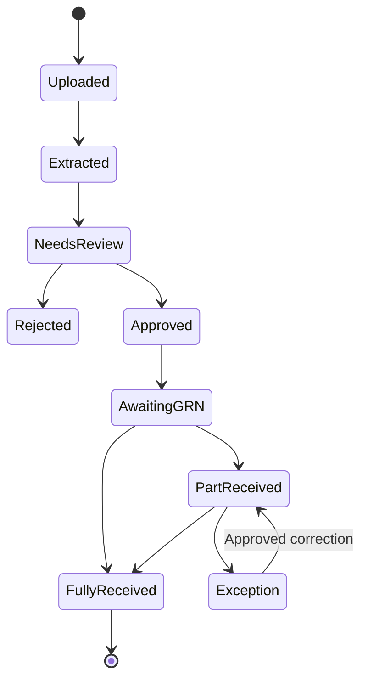
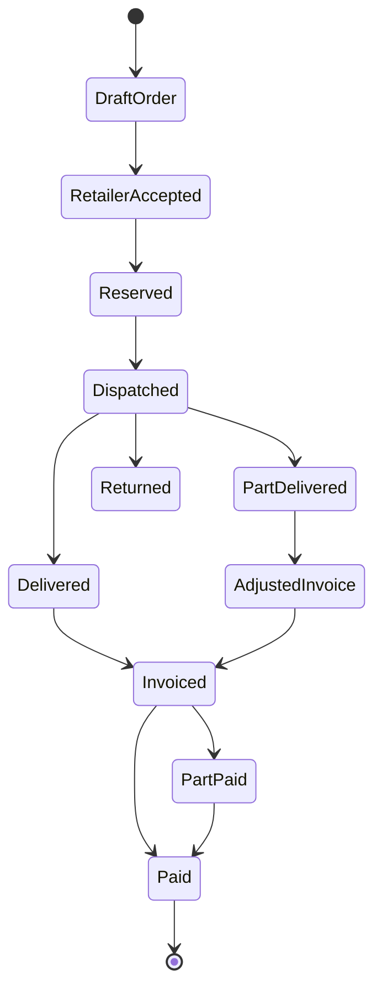
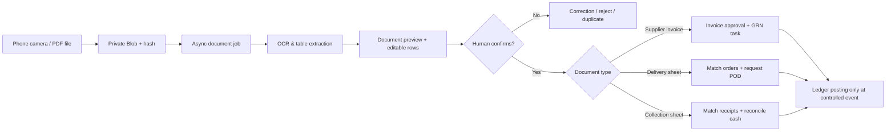
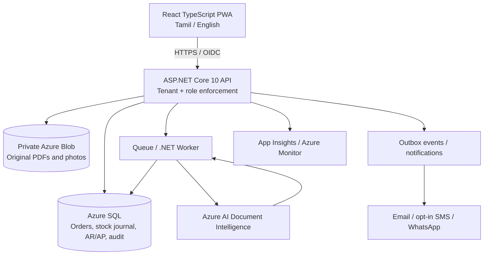

# BADRI TRADEFLOW
## Complete Software Requirements, Technology Architecture and Development Guide — v2.0

> **Project:** Badri TradeFlow — District Distribution Operating System  
> **Primary users:** FMCG, grocery, personal-care and general-trade distributors in Dharmapuri and nearby Tamil Nadu districts  
> **Edition:** Product requirements and engineering blueprint **v2.0**, 21 November 2026 (supersedes v1.1)  
> **Reference inputs:** Seven real-world documents, transcribed line by line in Appendix A: GK Road delivery sheet (Santhosh, 14 Nov 2026), R. Santhosh credit/debit/denomination sheet (14 Nov), Vijay Bommidi collection receipt (12 Nov), PA Traders A000770, Maha Enterprises ME0398 and MHHIN009140, Himalaya Wellness 5066110913. The working prototype built on these documents (Section 20) replaces the earlier mock PDFs, which contained figures that did not match the real documents.  
> **Implementation status:** This is a target specification. The existing prototype does **not** implement every function listed here.  
> **Data safety:** All example values in this document are demonstrations, not independently confirmed live trading balances. Never commit actual GST invoices, customer phone numbers, bank details or personally identifiable data to Git.

---

## 0. What changed in v2.0

v2.0 is the result of reading every uploaded document line by line, rebuilding the prototype on that real data, and reviewing the product as a whole. The main changes:

| # | Change | Why (evidence) | Where |
|---|---|---|---|
| 1 | **Capture-first product.** Direct in-app entry by salesman and warehouse is the main path; paper upload is the migration bridge. | Uploading a sheet after writing it adds work. The paper sheets also do not record payment mode, so they can never reconcile cash on their own. | FR-03, FR-18 |
| 2 | **Release plan replaces "build everything"**: R1 collections + cash close + receivables, R2 delivery + supplier bills + GRN, R3 stock + reorder, R4 multi-tenant SaaS. | 17 requirement groups before a single paying pilot is too much risk. Cash leakage is where the evidence is strongest. | Section 12.0 |
| 3 | **Earlier-collection ("HC") handling.** | Delivery sheet rows 11 and 24 carry "HC-3000" and "HC-1000"; the collection sheet credits exactly the remainder (₹3,679 = 6,679 − 3,000; ₹274 = 1,274 − 1,000). | FR-19 |
| 4 | **Paper marks are data, not noise**: circled rows, ticks, "G/P", "(F)", overwritten digits. | The 23 circled rows are exactly the shops on the same-day credit list (22 with an amount, plus Saravana Store's old bill). "G/P" appears only on circled rows and probably means G-Pay. | FR-20 |
| 5 | **Handwritten totals are unverified inputs.** The system recomputes and shows the difference and the most likely row. | Delivery sheet: lines ₹1,66,041 vs written ₹1,66,040. Santhosh credit: ₹1,12,754 vs ₹1,12,774 (ties if Kanagavalli = ₹3,024). Vijay: ₹34,186 vs ₹34,178 (ties if Velmurugan = ₹230). | FR-21 |
| 6 | **Payment mode is mandatory per receipt row**, and cash close compares notes only with cash rows. | Santhosh's sheet records ₹1,48,406 collected (₹1,12,774 credit + ₹35,632 debit) but ₹88,586 in notes. Only ₹22,746 is marked G/P. | FR-09, FR-10 |
| 7 | **Invoice reader requirements from real layouts**: rotated photos, batch and expiry inside the description, cases + eaches, free goods inside product names, tax-inclusive vs exclusive rates, page "1 of ?". | All four invoices differ. All recompute exactly to their printed totals when parsed correctly. | FR-22 |
| 8 | **E-invoice QR/IRN first, OCR second.** | ME0398 carries an IRN, Ack No. and signed QR. MHHIN009140 has a blank IRN field. | FR-23 |
| 9 | **Opening balances and data migration** are a release gate. | Santhosh's ₹35,632 debit block and every row on Vijay's sheet are against bill numbers that are not on any uploaded delivery sheet. | FR-24 |
| 10 | **Compliance named, not implied**: DPDP Act 2023, GST e-invoice and e-way bill, data residency. | v1.1 said "applicable privacy obligations" only. | Section 11.2 |
| 11 | **Owner decisions get recommended defaults**, so the build is not blocked. | Section 13 listed six open decisions with no default. | Section 13 |
| 12 | **Traceability, pilot metrics and launch gates** added. | Coverage could not be checked; "launch" had no definition. | Sections 17–19 |

**Mock PDFs withdrawn.** The earlier 84-page mock mixed real figures with invented ones (for example ₹7,792, Santhosh Store's GK Road bill, was shown as Sri Lakshmi Stores' Bommidi due; ME0398 line items were invented). It also contained internal contradictions (₹78,450 payables vs ₹19,260 listed). The prototype in Section 20 uses only transcribed figures and replaces those PDFs for sign-off.

---

## 1. Executive decision

**Use C# / .NET 10 LTS as the main production backend language.** Prefer a **modular monolith** with strict business-domain boundaries over early microservices. Use **React + TypeScript** for the responsive web/mobile-first Progressive Web App (PWA). Use **Azure SQL or Azure Database for PostgreSQL** as the primary financial/stock transactional database, and **Azure Blob Storage** for source PDF and photo files. Use **Azure AI Document Intelligence** for extraction assistance plus a mandatory **human review stage**.

For the previously discussed Azure **Cosmos DB** preference: Cosmos DB can be used for document/state projections, tenant catalogs, or a purposely designed event/aggregate model; it should **not be selected automatically** as the only stock and accounting system. Standard Cosmos transactional batches are atomic **only within a logical partition**; cross-aggregate inventory and accounts workflows need careful consistency design. Microsoft has newer distributed-transaction capabilities which must be separately evaluated and load-tested before being assumed suitable. The lower-risk MVP is relational SQL for AR/AP and stock journals.

| Layer | Recommended software | Why this fits |
|---|---|---|
| Core application | **C# 14 / ASP.NET Core 10 Web API** | Mature business validation, strongly typed money/quantity operations, Azure tooling, long-term support |
| Web / mobile browser | **React + TypeScript + Vite PWA** | Lightweight Tamil/English responsive screens, shared code for desktop/Android browser, offline-ready architecture |
| PDF/scan processing | **.NET worker + Azure AI Document Intelligence** | Invoice OCR and generic layout/table parsing through official .NET SDK; review uncertain handwritten fields |
| Primary data store | **Azure SQL** (preferred) or PostgreSQL | Multi-table transactions, reporting, auditing, stock and accounts consistency |
| Documents | **Azure Blob Storage** | Immutable originals, version history, controlled download, scanned image/PDF storage |
| Background jobs | **Azure Storage Queue** initially; **Service Bus** if warranted | Async scanning, retries, safe backpressure; avoid overengineering for 1,000 records/month |
| Hosting | **Azure Container Apps** or Azure App Service; frontend Static Web Apps | Managed infrastructure and scaling without VM maintenance |
| Auth | **OIDC / Microsoft Entra External ID or equivalent** | Separate trader/employee identities, no tenant selection from browser as a security control |
| Telemetry | **Application Insights + Azure Monitor** | Error trends, job failures, owner audit logs and support diagnosis |
| Build / deploy | **GitHub Actions + Bicep** | Repeatable CI, testing and PaaS infrastructure deployment |
| Testing | **xUnit + FluentAssertions + Playwright + API contract/integration tests** | Business ledger reliability and easy-to-use role journeys |
| Optional ML utilities | Python only if experiments/custom-model training justify it | No need for a second backend language for normal OCR orchestration |

### .NET version guidance (verified 21 Nov 2026)

- **.NET 10 is the LTS option** (supported into November 2028) and is the recommended baseline for this new product.
- **.NET 11 exists as a short-term-support (STS) release** as of November 2026; prefer the stable LTS version for a small SaaS team.
- **.NET 8 reached the end of support on 10 November 2026.** The separate existing `document-upload-processing` GitHub repository describes a .NET 8 Azure Functions backend: upgrade that code path before adopting it as a production dependency.
- Use **`decimal` in C# and fixed-precision SQL `decimal(p,s)`** for INR, discounts and taxes; do **not** use floating-point money or rely on OCR totals for posted amounts.

### Language comparison

| Criteria | .NET / C# | Node.js / TypeScript | Python / FastAPI |
|---|---|---|---|
| Financial and inventory workflows | **Excellent fit** | Good with strict conventions | Good, requires numeric/typing discipline |
| Azure integration and SDKs | **Strong** | Strong | Strong |
| Single-language frontend/backend | No | **Yes** | No |
| Team structure for long-lived SaaS | **Strongly recommended** | Good alternative | Best as OCR/ML specialist or lean demo |
| Recommendation for Badri TradeFlow | **Primary production backend** | Frontend language | Retain old prototype as reference; optional specialist services |

---

## 2. Product scope and usability principles

### 2.1 The promise to the trader

Every morning the owner opens one dashboard and immediately sees:

1. **Stock available today / இன்று இருப்பு** — physically counted + posted stock, less reservation and unusable units.
2. **What should I buy? / என்ன வாங்க வேண்டும்?** — reorder recommendations, expected supplier lead time and carton counts.
3. **Money to collect / வர வேண்டிய பணம்** — shop/beat/salesman-wise amounts, partially paid and overdue.
4. **Money to pay / செலுத்த வேண்டிய பணம்** — supplier invoices, due dates, part payments and credits.
5. **Today's deliveries / இன்றைய டெலிவரி** — dispatched, delivered, missing items and proof.
6. **Today's cash / இன்றைய வசூல்** — recorded cash, UPI pending verification, denomination count and handover differences.

### 2.2 Usability for non-IT and lower-literacy users

- Use **Tamil + English** labels consistently, with an option for **Tamil-first** display; validate translations with actual local traders.
- Show **five or fewer primary actions per role home screen**, not an ERP sidebar of 30 menus.
- Use **large, high-contrast buttons**, readable 16–18 px body text, clear icon-plus-word combinations and low typing.
- **Colour is supportive, not the only signal**: green = verified/completed, amber = needs review, red = blocked/overdue, grey = draft, blue = information.
- Suggested theme: **saffron/orange `#F97316`** primary, **deep maroon `#641B2E`** titles, **cream `#FFF8ED`** backgrounds, **leaf green `#15803D`** verified, **warning red `#B91C1C`**, **charcoal `#27313A`** text. Keep accessible contrast; avoid bright orange body text on white.
- Every critical form uses a **three-step pattern**: `Choose → Check → Confirm`, with obvious Back and Edit.
- Support smartphone camera capture, PDF selection, compressed photo, and file progress/errors.
- Confirm results using plain language: `Payment recorded but bank confirmation pending`, not `txnStatus = PENDING`.
- Offer **print/share receipt** and do not require retailers to install an app.
- Support low network coverage: cache assigned beats/orders; queue only allowed offline operations; show **Not yet synced** clearly and prevent duplicated sync.
- No silent deletion; show what changed and who approved it.

### 2.3 Platform and domain scope

Badri TradeFlow is **one SaaS platform with multiple subscribing trader tenants**. A trader sees only their own employees, retailer/customer accounts, supplier records, stock and documents. The platform owner manages subscription and reliability, but cannot browse commercial data by default.

---

## 3. Evidence from the seven uploaded documents

| Uploaded source | Real document characteristic | Product behaviour |
|---|---|---|
| Santhosh beat-wise delivery/bill-value sheet, GK Road | Many retailers and handwritten bill values | Route/beat roster; match invoice and retailer; scan-to-draft; reconcile delivered/undelivered |
| R. Santhosh credit/debit/denomination sheet | Credits, debits, other amounts and note counts | Allocate payment and adjustments separately; verify cash count; supervisor approval |
| Vijay daily collection receipt, Bommidi | Invoice/bill numbers, shops, cash denominations | Bill-linked collection upload, partial payment, employee handover, cash reconciliation |
| PA Traders GST invoice **A000770** | Credit-bill label; 5% tax lines; promotional stock | Commercial invoice verification, supplier payable, free units, separate physical receipt |
| Himalaya Wellness purchase invoice | Batch, MFD, expiry, multiple pack sizes, scheme values; continues to page 2 | Full multipage capture, batch/expiry and unit conversion |
| Maha Enterprises invoice **ME0398** | HSN, tax rates, GST and gross/net values | GST-level verification and supplier normalization |
| Maha Enterprises detailed invoice **MHHIN009140** | Multiple SKUs, discounts, quantities/cartons, expiry | Line-level review, PO/GRN reconciliation, products/catalog mappings |

**Verified readings (v2.0, full detail in Appendix A).** These are invoice values and handwritten figures, not confirmed balances:

- PA Traders A000770: **₹57,977** grand total. All 10 lines recompute (rates are GST-inclusive; the ₹200 discount is applied after tax).
- Maha ME0398: **₹26,059** net. All 4 lines recompute; both GST slabs (5% on ₹14,372.56, 18% on ₹9,294.57) tie.
- Maha MHHIN009140: 18 lines on page 1 recompute; the invoice total is not visible in the photo.
- Himalaya 5066110913: 9 lines on page 1 recompute; the total is on page 2, which is missing.
- Vijay Bommidi: rows 1–11 add to ₹34,186. The written subtotal ₹34,178 ties if row 7 is ₹230 rather than ₹238. The notes total ₹34,172, so the **₹6 gap remains**. ₹17,522 (RM ₹13,994, Bala S/M ₹3,528) is written below the subtotal and belongs to no total.
- R. Santhosh: credit ₹1,12,774 written (₹1,12,754 by line, ₹20 apart); debit ₹35,632 ties; notes ₹88,586 tie. Payment modes are not written, so the cash gap cannot be explained from paper alone.

Never auto-post a shortfall or a balance from any scan.

The words **“entry done”** on a supplier invoice mean only that someone may have recorded it; they do not prove stock receipt, verified accounts posting or cleared payment.

---

## 4. Roles, permissions and daily screens

| Role | Home screen | Primary actions | No access to |
|---|---|---|---|
| SaaS operator | Tenant plans, onboarding, service status | Create/disable tenant, manage subscription, support with audited consent | Trader bills and bank details by default |
| Trader owner | **Daily Control Center** | Approve purchase/returns/overrides, see all AR/AP/stock, close settlement | No silent deletion of posted ledgers |
| Purchase & accounts | **Document Inbox / Accounts** | Upload, review, map, approve within policy, reconcile AR/AP, send supplier payments for approval | GRN stock acceptance unless explicitly dual-authorized |
| Warehouse employee | **Today's Receipts & Dispatches** | Count goods, GRN, batches, damage, returns, pick/pack/dispatch | Supplier bank transfers, cash settlement approval |
| Salesman/delivery | **My Beat / இன்றைய கடைகள்** | Order, dispatch handoff, POD, record collections, submit cash count | Other beats/tenants, vendor banking, stock override |
| Retailer (no-login link or optional portal) | **My Order / என் ஆர்டர்** | Accept order, acknowledge delivery, view bill, verify receipt/dispute | Other retailers' records |
| Optional supervisor | **Exceptions** | Review shortages, escalations, field approvals | Global platform tenancy administration |

**Access policy:** API must enforce a server-derived `tenantId`, user identity, branch/beat authorization and action-specific role; hiding a button on the screen is never sufficient. Two-person approval (maker/checker) should be configurable for high-value supplier payments and risky adjustments.

---

## 5. Complete functional requirements

### FR-01 — SaaS tenant, subscription and branding

- Tenant onboarding: company name, GSTIN where applicable, district, timezone Asia/Kolkata, default language, owner identity.
- Tenant-specific logo, PDF invoice footer, receipt template, contact information, currency INR and payment terms.
- Subscription: Starter / Growth / Pro, trial, seats, plan limits, invoice/OCR quota, fair-use policy, monthly or annual billing, payment status, renewal reminders.
- Suspended account: read-only/export route where contract requires; clear retention/recovery policy.
- Platform support: audited and time-bound access only after owner authorization; secure export and deletion lifecycle.

### FR-02 — Business masters

- Suppliers: GSTIN, address, contacts, default payment terms, credit days, account/bank details (safely protected), supported brands and lead time.
- Retailers: shop and owner name, mobile, beat, salesman, billing/shipping location, GSTIN optional, credit ceiling, outstanding opening balance, invoice terms.
- Beats: Dharmapuri, Bommidi, GK Road and configurable routes; staff mapping and visit frequency.
- Products: brand, product description, variants, SKU/barcode, HSN, GST tax category by effective date, MRP, sell price, purchase price, retail-unit and carton conversion, preferred supplier, reorder thresholds, scheme/free goods.
- Support retailer aliases and OCR fuzzy matching, with review before alias merge.
- Excel/CSV import with dry-run, duplicate preview and downloadable import error report.

### FR-03 — Universal Document Upload Center (**required**)

The primary home screen presents exactly three prominent document tiles: **Upload Supplier Invoice / சப்ளையர் பில்**, **Upload Delivery Sheet / டெலிவரி சீட்டு**, **Upload Collection Sheet / வசூல் சீட்டு**.

Common flow:

1. Choose type (or auto-suggest with confirmation).
2. Choose PDF, phone camera or image (PDF, JPG, PNG; configurable maximum size/page count).
3. Preview document and select additional pages; show status and estimated page count, not fabricated extraction certainty.
4. Upload directly to private Blob storage with short-lived, tenant-scoped permission; complete + checksum verification.
5. Malware/type validation and `SHA-256` deduplication; retain raw original and immutable `documentId`.
6. Queue extraction job with retry/idempotency and per-tenant processing limits.
7. Present **side-by-side source image and editable extracted rows** with flags (unclear handwriting, totals mismatch, missing bill number, GST or quantity issues).
8. Employee corrects values and explicitly confirms; supervisor handles flagged exceptions.
9. Generate **draft business records only**; do not immediately post physical stock, final customer payments or delivery completion from OCR alone.
10. Final status: `Draft → Uploaded → Processing → Review Required → Verified → Approved/Posted` or `Duplicate/Rejected/Failed` with audit.

**v2.0 — capture-first.** Upload is the bridge from paper, not the destination. The target daily flow is:

1. Salesman records each collection in the app at the shop: bill, amount, mode (cash / UPI / cheque), receipt number issued at once.
2. Warehouse counts goods into the GRN screen directly.
3. Evening cash count uses the app's own cash receipts as the expected figure.

Paper upload remains for (a) supplier invoices, which arrive on paper, (b) the migration period, and (c) shops or staff not yet on the app. Pilot success is measured by the share of collections captured directly (target ≥ 80% by week 6, Section 18).

**Do not assume the prebuilt invoice model reads Tamil handwritten collection sheets reliably.** Use the layout/read model and test against these actual forms; if handwritten results are weak, a field-by-field manual-assisted entry workflow is the MVP fallback.

### FR-04 — Supplier invoice PDF (purchase side)

- Examples: PA Traders A000770, Himalaya Wellness, Maha Enterprises ME0398 and MHHIN009140.
- Extract/review supplier GSTIN, buyer GSTIN, invoice number/date/due date, document type, HSN/SKU, quantities, cartons/pieces, free units, batch, MFD, expiry, MRP, purchase rate, discounts, SGST/CGST/IGST, taxable and grand total, IRN/QR if present.
- Check duplicate by tenant + supplier identity + invoice number and document hash.
- Match purchase order and prices if PO exists; allow unmatched supplier invoices in a controlled queue.
- Flag missing pages, tax errors, repeated line items and receipt differences.
- Commercial invoice acceptance **must not increase on-hand stock**.
- Approved invoice produces a supplier-payable candidate under the chosen accounting control and a `Pending GRN` warehouse task; prevent financial double-booking on GRN.
- Supplier dispute, debit note and cancellation workflow with full traceability.

### FR-05 — Warehouse opening balance, GRN and perpetual stock

- Opening physical count by SKU, location, batch, manufacture/expiry, paid/free units; owner signs off initial balances.
- GRN scans/counts actual accepted goods; record received vs invoiced difference, damage, shortage, free units, batch mismatch and rejected cartons.
- Posting GRN creates immutable stock-movement journal and appropriate cost valuation entries.
- `OnHandSaleable = Opening + GRN + saleable returns + approved adjustments - dispatch - damage/writeoff - transfer-out`; exclude quarantined/expired items.
- `AvailableToPromise = OnHandSaleable - Reserved`.
- Track batch/expiry, FEFO picking, products near expiry, non-sellable returns, warehouse location and physical stocktake variance.
- Allow historical correction by **compensating adjustment** with reason/approval, never by deleting posted movement.
- Count original paid/free units independently; free units still increase physical quantity but carry their appropriate cost/scheme treatment.
- Inventory valuation method (weighted average or FIFO) must be chosen with accountant and applied consistently.

### FR-06 — Smart reordering and purchasing

- Each SKU has daily demand estimate, lead-time days, safety stock, supplier MOQ, pack multiple, target cover days and inventory inbound.
- `ReorderPoint = AvgDailySales × LeadTimeDays + SafetyStock`.
- `InventoryPosition = AvailableToPromise + ConfirmedIncomingPOQty`.
- Alert if inventory position <= reorder point; show expected stockout date.
- `SuggestedBuy = max(0, TargetCoverDays × AvgDailySales + SafetyStock - InventoryPosition)`, rounded to case/carton and supplier MOQ.
- Filter poor movers, slow sales, near-expiry stock and limits of cash available before suggesting quantities.
- Owner confirms purchase order; print/email/WhatsApp export with permission. No auto-payment/auto-order to external suppliers without approval.

### FR-07 — Retailer sales, credit and invoices

- Field order capture by retailer, product, quantity, offer and price; simple number pad and recent-products shortcuts.
- Credit limit check including current unpaid orders; owner authorizes exceptions with reason.
- Invoice generation with unique tenant-defined numbering, applicable taxes, quantity, discount and credit due date.
- Track quotes/order acceptance, confirmed orders, reserved stock, picked/dispatched order and sales invoices independently.
- Partial acceptance/cancellation and GST-compliant credit-note process according to confirmed rules.
- Send order acknowledgment to retailer via opt-in channel or printed slip.

### FR-08 — Beat planning, dispatch and delivery PDF

- Plan routes for Santhosh GK Road, Vijay Bommidi and configurable beats.
- Upload handwritten/printed delivery sheet PDF; extract row number, retailer, bill no/value, beat, date, salesman and marks; manual reconciliation to existing invoices.
- Distinguish `Sheet Scanned` from `Goods Dispatched` and `Proof of Delivery Received`.
- Warehouse picks and releases stock by batch; salesman sees only his route, preferably offline.
- Retailer can accept/short-receive/reject goods; POD requires receiver name and optional OTP/signature/photo/time/geolocation with consent.
- Partial delivery, no-shop, wrong shop, damaged-in-transit, return-to-warehouse and credit-note workflow.
- End-of-day undelivered and stock-return reconciliation.

### FR-09 — Collection PDF and customer payment

- Upload Vijay/Bommidi-style collection receipt or R. Santhosh credit/debit/denomination sheet; identify salesman, beat, date, bill number, retailer and amounts.
- Differentiate credit, debit adjustment, cash receipt, electronic payment, salesperson advance and other expense. Do not combine them as undifferentiated cash.
- Match each payment to one or several specific receivable invoices; support part payments and overpayments/unallocated advance.
- Capture methods: **cash**, **UPI**, bank transfer, cheque; store reference and status.
- For cash, issue provisional receipt when salesman receives money; owner cash handover/denomination reconciliation remains separate.
- For UPI/bank, receipt status is **Pending Verification** until credible bank/payment-provider reconciliation; no confirmation solely on a screenshot.
- Auto-generate numbered retailer receipt with paid amount, remaining balance, bill(s) and payment state. Share as PDF/print/consented WhatsApp/SMS; retailer may dispute/acknowledge.
- Duplicate upload, payment reference or retry must not double-credit the invoice.
- **v2.0:** Payment mode is required on every row before a sheet can be verified. The review screen pre-fills "UPI" where the paper shows "G/P" and asks the reviewer to confirm. A "mark remaining rows as cash" action exists but is logged.
- **v2.0:** A sheet section of payments against older bills (Santhosh's "Debit" block, bills 5466–6221) is kept against the bill number as an unallocated receipt until that bill exists (FR-24).
- **v2.0:** A cash receipt reduces the retailer's due only when the salesman's cash close is approved; a UPI/cheque receipt reduces it only when matched to the bank statement. Until then it shows as "received, not cleared".

### FR-10 — Cash denomination, handover and settlement

- Count ₹500, ₹200, ₹100, ₹50, ₹20, ₹10 notes and relevant coins (denominations configurable with legal availability).
- Link expected cash to verified collected cash by employee/date/route and distinguish non-cash payments.
- Display `Expected vs Counted`, shortage/surplus and unexplained debit/expense.
- Shortage requires reason, evidence and owner approval; never silently auto-close.
- Cash stages: `Collected by salesman → Submitted to office → Owner verified → Deposited in bank`.
- Printable daily collection report with exceptions and approvals.
- **v2.0:** Expected cash = sum of verified cash receipts for that salesman and day, adjusted for any "Others" lines the reviewer classifies (expense paid from the bag, extra cash collected, or not money). Santhosh's "Others" box (Priyan S/M ₹282 + Others ₹50 = ₹332) must be classified before close.
- **v2.0:** Submit requires a reason when the difference is not zero (recount, mode wrong, handwriting misread, expense, salesman shortage, unknown). Owner approval closes cash, issues a settlement reference and clears the cash receipts.

### FR-11 — Accounts Receivable (AR) / retailer dues

- Per-retailer: opening dues, invoices, due dates, payments, cash pending transfer, cleared UPI, credit notes, disputes, aging buckets and contact history.
- Owner view: **due today**, **overdue**, **0–7 / 8–30 / 31–60 / 60+ days**, by beat/salesman.
- `Outstanding = Posted invoices + opening debits - cleared allocated receipts - approved credit notes - approved writeoffs`, adjusted for reversals.
- Follow-up task, partial collection, promised-to-pay date, reminder/share statement, credit-hold policy.
- Never reduce retailer dues because salesman merely photographed money or uploaded a paper sheet.

### FR-12 — Accounts Payable (AP) / supplier bills to pay

- Supplier invoice ledger with bill/GRN match, due date, terms, eligible credits, disputed quantity/value and paid/unpaid state.
- `Supplier outstanding = Approved invoice liability + opening payable - cleared payments - posted supplier credits`, subject to reversals.
- View **due today/this week/overdue** and cash required for purchase orders.
- Maker/checker for supplier bank payment; record reference, approver, date and payment rail. Do not store online banking secrets.
- Support partial settlements, debit/credit notes, supplier statement reconciliation, and no duplicate-payment posting.
- The visible sample invoice amount is **invoice value**, never assume it is the current amount due without payment history.

### FR-13 — Retailer confirmation experience

- Secure, retailer-specific, short-lived, optionally one-time links for order, POD and receipt acknowledgment; no customer account required initially.
- Order confirmation, delivery quantity confirmation and payment receipt are **three distinct actions**.
- Retailer may see own invoices and due balance, raise discrepancy, download receipt, request callback, and acknowledge payment.
- All links are scoped to a specific record and expire; no cross-retailer discovery or unauthenticated invoice listing.

### FR-14 — Returns, schemes, inventory exceptions

- Sales return and purchase return, credit-note approvals, resalable/non-saleable stock, damaged packaging and expired goods.
- Vendor and retailer promotional `X + Y free`, carton/eaches conversion and scheme expiry; keep scheme stock visibility.
- Adjustment reasons and audit event required; zero or negative quantities not silently allowed.

### FR-15 — Reports and owner control

- Owner daily overview: sellable units, stock value, expiring/slow movers, reorder priority, deliveries pending, retailer dues, supplier dues, expected collections, shortfalls, clearing status.
- Retailer statement, supplier statement, salesperson beat performance, cash handover, day-wise collection register, sales & purchase registers, GST-rate summaries, product sales/returns, dead stock.
- CSV/Excel/PDF exports scoped to tenant/role; exported reports contain `As of` time and source transaction identifiers.
- Cash-in/cash-out forecast for next 7/30 days; clearly separate collection forecast from profit.

### FR-16 — Notifications and offline

- Low stock, near expiry, failed delivery, customer overdue, supplier due, pending invoice review, unapproved settlement, duplicate PDF.
- SMS/WhatsApp only with consent, sender compliance, retry/opt-out; do not claim integration is implemented until provider verification.
- Android browser PWA caches catalog, assignments and draft forms; encrypted local storage where justified; queued commands use device-generated idempotency keys and server-side conflict resolution.
- Display `Saved on phone / Not synced`, last sync and duplicate-warning states; cash collection synchronization must not create duplicate receipts.

### FR-17 — Governance, audit and support

- Immutable/auditable transitions for invoices, GRNs, stock, payments, settlement, roles and subscription changes.
- Operational support can see errors/metadata without unrestricted trader business content.
- Owner export, legal retention rules, backup/restore, support ticket, blocked-user recovery, account closure and billing history.

### FR-18 — Direct field capture (salesman app)

- Beat list for the day with each shop's open bills, balance and delivery status.
- Three separate actions per shop: **Delivered / Short / Damaged** (proof of delivery), **Collect** (receipt), **Note** (promise-to-pay, dispute).
- Collect: bill, amount (cannot exceed open balance; excess goes to an office-approved advance), mode, UPI reference optional. Receipt number issued immediately; printable and shareable.
- Works offline: entries saved on the phone with a device-generated idempotency key; "Not synced" badge; sync applies each entry exactly once.

### FR-19 — Earlier collections ("HC") and part payments

- A bill can carry an earlier collection noted on paper (for example "HC-3000"). The system creates an **unproven earlier-collection receipt** for that amount and asks for its original receipt or owner acceptance.
- Owner may **accept** (receipt cleared, audit entry with reason) or **reject** (amount stays due).
- Sheet credit for the remainder (₹3,679 for Angalamman S/M; ₹274 for Kovai Lala) is matched to the same bill.
- The meaning of "HC" must be confirmed with the sales team in discovery; the data model supports any prior-collection marker.

### FR-20 — Paper marks and legends

- Each sheet template stores its legend (GK Road sheet header: "Paid – ✓, G/P – ○, Dam – ✗") and mark types: circled serial, ticked/struck serial, cross, tag text beside a name ("G/P", "(F)", "S/M", "HC-n").
- The reader records each mark as a field, not as noise. The review screen shows what each mark appears to mean and asks the reviewer to confirm.
- Observed in the samples: circled rows equal the same-day credit list; "G/P" only on circled rows (likely G-Pay); "(F)" after shop names (meaning to confirm); margin notes such as "Ant Rob No – 1st" and "SEN ELO Gel – 20 Ish" (meaning unknown).

### FR-21 — Handwritten totals and overwritten digits

- Every handwritten total is stored as a **claimed total** and compared with the computed line sum. The difference is shown before confirmation.
- Where one plausible correction makes the claimed total tie, the system suggests it with its evidence (Kanagavalli Store ₹3,004 → ₹3,024, matching the delivery bill; Velmurugan ₹238 → ₹230), and logs it if accepted. It never applies a correction silently.
- Overwritten or unclear digits, struck values and pencil notes are flagged per row (17 rows on the GK Road sheet).
- Cross-document checks: same shop on delivery and collection sheets with different amounts (Dhanshika ₹1,760 vs ₹1,750; Ganga ₹4,861 vs ₹4,867) are flagged as possible part payment, over-payment or misread.

### FR-22 — Supplier invoice reader (from the four real layouts)

| Requirement | Seen on |
|---|---|
| Auto-rotate photos | Himalaya (rotated 90°) |
| Tax-inclusive rate (`amount = qty × rate`, taxable = amount ÷ 1.05) and discount after tax | PA Traders |
| Tax-exclusive rate with scheme amount (`(qty × rate − scheme) × (1 + GST)`) and round-off | Maha ME0398 |
| Cases + eaches (`1CA 0EA` × UOM) and units-per-case | Maha MHHIN009140 |
| Batch and expiry **inside the description**, several batches per line (`305196567L-3 \| 305196568L-5 \| 305196570L-16 · Exp 09/28`) | Maha MHHIN009140 |
| Batch, MFD and expiry as columns; scheme discount on a separate bracketed line; PTR | Himalaya |
| Free goods as a ₹0 line (PA "60 FREE"), or inside the product name ("+25% FREE", "BUY 5 GET 1 FREE") | PA, Maha, Himalaya |
| Page count missing or partial ("Page 1 /", "Continued in Page 2"); approval blocked until complete | MHHIN009140, Himalaya |
| Handwritten marks on the invoice ("entry done", "8 cls", circled "28", Tamil note) captured as annotations, never as data | All four |
| Due date sanity: credit bill with due date = invoice date; "Terms of Payment: 365" | PA, MHHIN009140 |

Every line is recomputed and every printed total checked (sub-total, slab taxable, CGST = SGST, round-off, grand total). A line that does not tie blocks approval until corrected.

### FR-23 — E-invoice and structured import before OCR

- If the invoice has an e-invoice QR, decode it first: supplier GSTIN, buyer GSTIN, invoice number, date, value, IRN. These fields are then **verified**, not read.
- Support supplier exports where available (many distributors bill from MARG, Busy or Tally; PA Traders' invoice footer shows MARG ERP). CSV/Excel import with mapping beats OCR.
- OCR handles only what structured sources cannot.

### FR-24 — Opening balances and migration

- Go-live requires: opening stock count by product and batch (owner signs off), each retailer's unpaid bills (bill no., date, amount), each supplier's unpaid bills and advances.
- Until a bill exists, receipts against its number stay **unallocated** and visible on the owner's dashboard ("collected against bills not in the system").
- Import via spreadsheet with a dry run, duplicate preview and error report (FR-02).

### FR-25 — Source-document fidelity

- Every posted figure links to the document, page and row it came from, plus who confirmed it.
- Paper "as written" and system "as read" are shown side by side in every review screen.
- Corrections keep both values.

---

## 6. Business state machines — non-negotiable

### 6.1 Supplier invoice + goods receipt



**The `Approved` transition does not add stock. Only posted accepted GRN quantity adds stock.** A payable is posted according to the agreed accountant-approved purchase accounting policy, once only.

### 6.2 Retailer order to collection



The actual event model may differ, but **POD, invoicing, money received, verified payment, and salesman cash handover** must have distinct timestamps and audit entries.

**v2.0 default (until the accountant confirms):** the sales bill exists before dispatch (that is how the samples work: bill values are on the delivery sheet). The delivery confirmation, the receipt and the cash/bank clearance are separate events after it. If the accountant chooses invoice-on-delivery, the bill becomes a "proforma" until POD.

### 6.3 PDF-to-posting pipeline (all 3 document types)



---

## 7. Recommended system architecture



### Architecture approach

1. Build **one modular .NET solution**; keep Invoice, Stock, Sales, Collections and Accounting domains separate in code and database interfaces.
2. Use domain events and an **outbox** for async notifications and derived reports; never make accounting success depend on sending WhatsApp.
3. All write endpoints accept `Idempotency-Key` for dispatch, GRN, payment and cash close; verify uniqueness with a tenant-scoped persistence constraint.
4. Use EF Core 10 migrations, relational constraints, optimistic concurrency (`rowversion`/concurrency token), and database transactions for ledger posting.
5. Background worker processes a job and persists the extraction draft once; the reviewer confirms before business posting.
6. Use read models/cached dashboard queries as volume grows; accounting journals remain the source of truth.

### Azure Cosmos DB alternative (if explicitly required)

- Start with a bounded architecture proof-of-concept before choosing Cosmos for the system of record.
- Document partition key choice, maximum logical partition usage, tenant isolation, RU consumption, query cross-partition cost and batch boundaries.
- Inventory quantities, AR/AP and payments cannot safely rely on uncoordinated multi-container writes.
- A Cosmos-only implementation needs versioned aggregates, transactional batch where applicable, an outbox, compensating transactions, invariants and formal concurrency tests.
- **Recommendation:** first build on Azure SQL and document an optional Cosmos read-model/event-stream layer only if justified by scale or integration requirements.

---

## 8. Production repository structure

```text
badri-tradeflow/
├── README.md
├── docs/
│   ├── SOFTWARE_REQUIREMENTS.md
│   ├── architecture/
│   │   ├── domain-model.md
│   │   └── adr-0001-dotnet-and-relational-ledger.md
│   ├── product/
│   │   ├── tamil-english-ux.md
│   │   └── uat-sample-scenarios.md
│   └── operations/runbook.md
├── src/
│   ├── BadriTradeFlow.slnx
│   ├── TradeFlow.Api/            # Auth, REST API, OpenAPI
│   ├── TradeFlow.Domain/         # Domain entities, invariants, value objects
│   ├── TradeFlow.Application/    # Business use cases and commands
│   ├── TradeFlow.Infrastructure/ # EF Core, Azure Blob, queues and adapters
│   ├── TradeFlow.Worker/         # Document extraction and queued jobs
│   └── TradeFlow.Contracts/      # API and integration contracts
├── web/                          # React + TypeScript + Vite PWA
│   ├── src/features/
│   │   ├── home/
│   │   ├── upload-center/
│   │   ├── purchases/
│   │   ├── stock/
│   │   ├── orders/
│   │   ├── delivery/
│   │   ├── collections/
│   │   ├── receivables/
│   │   ├── payables/
│   │   └── platform-admin/
│   └── src/i18n/{en,ta}.json
├── tests/
│   ├── TradeFlow.UnitTests/
│   ├── TradeFlow.IntegrationTests/
│   ├── TradeFlow.ContractTests/
│   └── e2e/                      # Playwright role flows
├── infra/                        # Bicep for Azure resources
├── .github/workflows/
│   ├── ci.yml
│   └── deploy-dev.yml
└── sample-data/                   # Synthetic fixtures only
```

> Existing code: the local working demonstration currently uses **Python FastAPI + SQLite + vanilla JavaScript** and offers a functional learning baseline. The connected `Muthukumar123/document-upload-processing` repository has a separate Azure document-ingestion application. Neither is a ready-to-deploy .NET 10 Badri TradeFlow SaaS. Implement the new .NET solution deliberately, reusing only vetted upload/queue patterns and porting business tests.

### Initial project commands

```bash
# Requires .NET 10 SDK
mkdir badri-tradeflow && cd badri-tradeflow
dotnet new sln -n BadriTradeFlow
dotnet new webapi -n TradeFlow.Api -o src/TradeFlow.Api -f net10.0
dotnet new classlib -n TradeFlow.Domain -o src/TradeFlow.Domain -f net10.0
dotnet new classlib -n TradeFlow.Application -o src/TradeFlow.Application -f net10.0
dotnet new classlib -n TradeFlow.Infrastructure -o src/TradeFlow.Infrastructure -f net10.0
dotnet new worker -n TradeFlow.Worker -o src/TradeFlow.Worker -f net10.0
dotnet sln BadriTradeFlow.slnx add src/TradeFlow.*/*.csproj
# The .NET 10 SDK defaults to the .slnx solution format. Verify folder paths on your machine.

# Web (Node LTS required)
npm create vite@latest web -- --template react-ts
cd web && npm install && npm run dev
```

**Coding conventions:** C# nullable enabled, validation at API and domain boundary, global error contract (`ProblemDetails`), OpenAPI, UTC timestamps saved in DB and rendered in IST for Indian users, `decimal`/exact rounding, English error codes plus Tamil/English localized messages, per-tenant data tests, no secrets in source control.

---

## 9. Data model: tables / entities

### 9.1 Core tables

| Entity | Essential fields / rules |
|---|---|
| `Tenant` | `Id`, `Name`, `GSTIN?`, `Status`, `Locale`, plan/billing IDs |
| `User`, `Membership`, `Role` | Auth subject, tenant-scoped membership, active, last login |
| `Supplier`, `Retailer`, `Beat`, `StaffBeat` | Contact and payment terms, route, credit limit, authorized employee |
| `Product`, `SkuAlias`, `PackConversion`, `TaxRateHistory` | Code, unit ratios, HSN, valid-from tax rate, MRP and schemes |
| `Document`, `DocumentPage`, `DocumentExtraction`, `DocumentIssue` | Blob key/version/hash, origin, type, extracted JSON, confidence and correction trail |
| `PurchaseOrder`, `PurchaseOrderLine` | Supplier, ordered qty, unit, cost, expected date, approval |
| `PurchaseInvoice`, `PurchaseInvoiceLine` | Invoice number/date/terms/HSN/tax/discount/paid/free/batch |
| `GRN`, `GRNLine` | Invoice/order relation, accepted/damaged/rejected/free quantities, warehouse |
| `StockBatch`, `StockMovement`, `StockReservation`, `StockCount` | Product, batch, expiry, quantity, movement type, source document, audit |
| `SalesOrder`, `SalesOrderLine`, `SalesInvoice`, `SalesInvoiceLine` | Retailer, tax, quantity, due date, lifecycle, sale price |
| `Delivery`, `DeliveryLine`, `POD`, `DeliveryException` | Beat, driver, status, receiver, evidence and shortages |
| `Collection`, `CollectionAllocation`, `CashBag`, `Denomination` | Payment mode, status, invoice allocation, cash handover |
| `AccountsReceivableEntry`, `AccountsPayableEntry` | Signed journal entries, source, posting date and reversal links |
| `SupplierPayment`, `PaymentApproval`, `CreditNote`, `Return` | Cleared status, payment refs, credited balances and stock dispositions |
| `AuditEvent`, `OutboxEvent`, `IdempotencyRecord`, `Notification` | Actor, tenant, old/new status, correlation, delivery/retry state |
| `Subscription`, `SubscriptionInvoice`, `PlanQuota` | Usage, user seats, document pages, renewal, external billing reference |
| `SheetTemplate`, `PaperMark`, `ClaimedTotal` (v2.0) | Legend per sheet type; mark per row (circle, tick, cross, tag); handwritten total vs computed, with accepted correction and evidence |
| `EarlierCollection` (v2.0) | Bill, amount, paper source (for example "HC-3000"), status Unproven → Accepted / Rejected, approver and reason |
| `OpeningBalance`, `UnallocatedReceipt` (v2.0) | Pre-go-live retailer and supplier bills; receipts held against a bill number until that bill exists |
| `InvoiceAnnotation` (v2.0) | Handwritten marks on supplier bills ("entry done", case counts) kept as notes, never as data |

### 9.2 Important constraints

- Every business table has **`tenant_id`** and relevant compound unique indexes, e.g. `(tenant_id, supplier_id, supplier_invoice_no)` for purchase invoices.
- Do not trust tenant IDs supplied in JSON query/body; derive from authenticated membership and enforce SQL access policy.
- Prevent negative saleable available quantity unless a formal adjustment workflow is approved.
- Money has explicit currency (`INR`), inclusive/exclusive tax logic and rounded totals; tax-rate changes are effective-dated.
- `StockMovement`, `AccountsReceivableEntry`, `AccountsPayableEntry` are **append-only logical journals** with reversals and posting references.
- Original document blobs are private. Upload and every export pass tenant and ownership checks.
- Every pending external transfer (UPI/bank) has `Pending`, `Verified`, `Failed`, `Reversed`; settlement follows clearance.

### 9.3 SQL example (illustrative only)

```sql
CREATE TABLE stock_movement (
  id UNIQUEIDENTIFIER NOT NULL PRIMARY KEY,
  tenant_id UNIQUEIDENTIFIER NOT NULL,
  warehouse_id UNIQUEIDENTIFIER NOT NULL,
  product_id UNIQUEIDENTIFIER NOT NULL,
  batch_id UNIQUEIDENTIFIER NOT NULL,
  source_type NVARCHAR(40) NOT NULL,
  source_id UNIQUEIDENTIFIER NOT NULL,
  quantity_delta DECIMAL(18,3) NOT NULL,
  event_time_utc DATETIME2 NOT NULL,
  reversal_of UNIQUEIDENTIFIER NULL,
  CONSTRAINT CK_StockMovement_NonZero CHECK (quantity_delta <> 0)
);
CREATE INDEX IX_StockMovement_Tenant_Product_Batch
  ON stock_movement (tenant_id, warehouse_id, product_id, batch_id);
```

All writes must run within transaction boundaries that also update reservation and ledger documents correctly; SQL above is not a full production schema.

---

## 10. Public API outline (v1)

API root `/api/v1/`; identity required except signed retailer acknowledgment endpoints. All operations are tenant-scoped. Do **not** implement these endpoints as unauthenticated demo routes.

| Method/path | Purpose | Security notes |
|---|---|---|
| `POST /documents/uploads/initiate` | Request upload session / delegated blob upload | Auth + tenant + file quota/size/type |
| `POST /documents/{id}/complete` | Hash/version registration and enqueue | Idempotent, immutable document source |
| `GET /documents/{id}` | Extraction status + original preview token | Signed, temporary download authorization |
| `POST /documents/{id}/review` | Save corrections and reviewer acknowledgment | Owner/accounts role according to type |
| `POST /purchase-invoices/{id}/approve` | Accept commercial document | Cannot add stock |
| `POST /grns` / `POST /grns/{id}/post` | Confirm physical goods and post stock | Warehouse + approval as configured |
| `GET /inventory?warehouseId=...` | On-hand, reserved, available, expiring | Tenant and warehouse scope |
| `GET /reorder-suggestions` | Reorder calculation with explanation | Read only; no auto-buy |
| `POST /purchase-orders` | Prepare/approve supplier order | Owner role for approval |
| `POST /sales-orders` | Create retailer order | Beat/customer permissions and credit checks |
| `POST /deliveries/{id}/dispatch` | Pick/issue stock | Warehouse, idempotency |
| `POST /deliveries/{id}/acknowledge` | Record POD and shortages | Evidence/receiver, signed-link controls |
| `POST /collections` | Capture payment + invoice allocations | Amount/clearing/idempotency controls |
| `POST /collections/{id}/verify` | Verify bank/UPI settlement | Accounts role and provider evidence |
| `POST /cash-bags` / `POST /cash-bags/{id}/close` | Cash handover and denomination matching | Owner review on mismatch |
| `GET /receivables/aging` | Retailer balances and aging | Owner/accounts and assigned beat rules |
| `GET /payables/aging` | Supplier bills to pay | Owner/accounts only |
| `POST /supplier-payments` / `POST /supplier-payments/{id}/approve` | Supplier payment workflow | Maker/checker threshold |
| `GET /reports/daily-control` | Owner daily KPIs and exceptions | Owner role, as-of timestamp |
| `POST /platform/tenants` | SaaS tenant creation | Platform operator only |

**Example status payload:** `{"documentId":"doc-123","documentType":"COLLECTION_SHEET","status":"REVIEW_REQUIRED","needsManualReview":true}`. The UI must never present this as “Collection Received” until accepted and matched.

---

## 11. Azure deployment and security

### 11.1 Environments

- `local`: Docker SQL/PostgreSQL and mock OCR; no real payment.
- `dev`: low-cost Azure PaaS, synthetic company records and controllable quotas.
- `uat`: representative redacted or consented invoices, mobile devices, Tamil translations, proper role authorization.
- `prod`: custom domain/HTTPS, least privilege, managed identity, backup, monitoring and incident response.

### 11.2 Minimal production topology

```text
User Android phone / laptop
    → HTTPS + WAF/rate limiting as risk demands
    → React PWA (Static Web Apps or equivalent)
    → Authenticated .NET API (Container Apps or App Service)
    → Azure SQL / PostgreSQL (private where feasible)
    → Blob Storage (private; original invoice/POD documents)
    → Queue + .NET worker → Azure AI Document Intelligence
    → Monitoring, secrets management, audited outbound notifications
```

**Secure defaults:** OIDC, owner MFA, role checks in API, server-verified tenant scope, encrypted storage/transport, scoped delegated upload, malware validation, document type and max size, Key Vault/managed identity, rate limiting, export audit, per-tenant quotas, cross-tenant integration tests, daily backups with restore drills, least-privilege CI deployment and non-production data redaction.

**Compliance gates (v2.0, named; each needs a qualified accountant or lawyer to confirm current rules before launch):**

| Area | What the product must do | Gate |
|---|---|---|
| **Digital Personal Data Protection Act 2023 (DPDP)** and its Rules | Retailer and staff phone numbers, names and addresses are personal data. Notice and consent at capture, purpose limitation, retention schedule, data-principal requests (access, correction, erasure), breach notification process, processor agreements with hosting/messaging vendors. | Privacy review before pilot data leaves the trader's premises |
| **GST e-invoicing (IRN)** | Read and verify IRN/QR on purchase invoices (FR-23). If a tenant's turnover requires e-invoicing for its own sales bills, integrate with an authorised IRP or GSP; never claim GSTN certification without it. | Accountant sign-off per tenant |
| **E-way bill** | Track e-way bill numbers on inbound consignments and on outbound movements where the value and distance rules apply (PA Traders A000770 at ₹57,977 is above the common ₹50,000 threshold). | Accountant sign-off |
| **GST records** | Purchase and sales registers by rate, HSN summary, credit/debit notes with original invoice reference. | Accountant sign-off |
| **Data residency** | Host in an Indian Azure region (Central India primary, South India for backup) unless the trader agrees otherwise in writing. | Architecture review |
| **Messaging** | SMS/WhatsApp only with recorded opt-in; DLT template registration for SMS; opt-out honoured. | Before enabling messages |
| **Payments** | No bank credentials stored; UPI clearance by bank statement or a licensed provider's callback; no payment links without the provider's terms. | Before enabling online payment |


### 11.3 SLO and load planning (proposed targets)

| Non-functional requirement | Initial target / test |
|---|---|
| API p95 response | Target < 800 ms for standard transactional reads under agreed load; benchmark required |
| Upload UX | Visible progress and processing status; retryable on poor network |
| Core ledger postings | Exactly-once business effect using idempotency + DB transaction, even with at-least-once job delivery |
| Data safety | Daily backup + recoverability test, documented RPO/RTO before paid rollout |
| Availability | Define paid support hours and production SLO before selling |
| Supported devices | Recent Android Chrome, desktop Chrome/Edge; test low-end Android over 3G/4G |
| Accessibility | Accessible contrast, keyboard navigation and large tap targets |
| Tamil quality | Native-speaker UAT for all critical messages, invoices and receipts |

---

## 12. Development phases and exit criteria

### 12.0 Release plan (v2.0 — supersedes the phase order below for scheduling)

| Release | Scope | Exit gate (must be true before the next release starts) |
|---|---|---|
| **R0 Discovery (1–2 wks)** | Interview Santhosh, Vijay, accounts and owner; confirm decisions 1–8 (Section 13); collect 30 sheets and 20 invoices (redacted copies for tests); measure today's baseline (Section 18). | Owner signs the meanings of all paper marks and the eight defaults. |
| **R1 Collections and cash (5–6 wks)** | Opening retailer balances (FR-24), salesman app with receipts and offline (FR-18), collection-sheet upload and review (FR-09, FR-19–21), cash count and close (FR-10), receivables and UPI verification (FR-11), owner dashboard and audit. Single tenant. | Two consecutive weeks where every cash close has a zero difference or an approved reason; ≥ 80% of collections captured directly by week 6. |
| **R2 Delivery and purchases (5–6 wks)** | Delivery sheet and POD (FR-08), supplier invoice reader + e-invoice QR (FR-04, FR-22, FR-23), approval separate from GRN (FR-05), payables with maker/checker (FR-12), returns and credit notes (FR-14). | All four sample invoice layouts recompute; no stock posted without GRN; no duplicate payable in a replay test. |
| **R3 Stock intelligence (3–4 wks)** | Opening stock count, batch/expiry and FEFO, reorder suggestions from real sales history (FR-06), purchase orders, reports (FR-15). | Stocktake variance under the threshold the owner sets. |
| **R4 SaaS launch (4–6 wks)** | Multi-tenant onboarding, subscriptions and billing (FR-01), support access controls (FR-17), second and third trader onboarding, production hardening. | Launch gates in Section 19 all met. |


**Estimates below are planning ranges for a small experienced team, not project commitments.** Effort depends heavily on mobile/offline scope, integrations and OCR accuracy.

| Phase | Indicative duration | Deliverable | Exit gate |
|---|---|---|---|
| **0. Product discovery** | 1–2 weeks | Final roles, screen list, 10–20 redacted real document examples, rules for stock/accounts | Owner approves journeys, Tamil terms, sample calculations |
| **1. Core foundation** | 2–3 weeks | .NET 10 solution, React app, OIDC, tenant onboarding, SQL schema, role policy, CI/CD | No cross-tenant data leaks, login/security tests |
| **2. Stock + purchases** | 3–4 weeks | Product masters, opening count, supplier invoice upload, review, GRN, batch stock, reorder | No stock before GRN; accurate stock count and supplier duplicates blocked |
| **3. Sales + delivery** | 2–3 weeks | Beats, order, invoice, dispatch, POD, delivery PDF import and returns | Retailer/customer/beat isolation; all delivery exception paths pass |
| **4. Collections + accounting** | 3–4 weeks | Collection PDF import, payment allocation, denominations, AR/AP, supplier settlement, statements | Cash mismatch control; AR/AP/stock ledger and payment replay tests pass |
| **5. Production hardening + pilot** | 3–5 weeks | Offline strategy, Tamil UAT, reports, backups, subscriptions, controlled support and onboarding | Trader UAT approval; verified recovery, monitoring and audit |

**Delivery sequence:** core local prototype → supplier invoice + physical GRN → stock dashboard/reordering → delivery/POD → collection scan/AR/AP → cash close → tenant subscription billing → production pilot. A sequential build may run roughly **14–21 weeks**, with overlap possible; this range is not a guaranteed estimate.

### Recommended team

- 1 C#/.NET full-stack engineer (backend/domain/integration)
- 1 React/TypeScript UI engineer (PWA/Tamil/UX)
- 0.5–1 QA / automation engineer (can be shared)
- Part-time solution architect/DevOps
- Part-time trader subject-matter expert + accountant/GST reviewer
- Native Tamil user tester who is not an IT professional

### Developer definition of done

- API contract and role permissions complete.
- Unit + integration + e2e happy/error path tests pass.
- PDF source and extracted values are clearly distinguishable.
- No ledger amounts can be posted twice by retry or duplicate upload.
- Tamil/English critical labels and receipts verified on Android.
- Every new ledger action has timestamp/actor/tenant/source and reversal strategy.
- Audit, alerting and restore documentation updated.
- Business owner accepts the real sample document scenario.

---

## 13. Acceptance/UAT scenarios directly inspired by your PDFs

| Scenario | What the trader does | Expected result |
|---|---|---|
| **UAT-01 PA Traders purchase invoice** | Upload invoice A000770, review ₹57,977 document | Invoice accepted; supplier liability recorded under policy; **no inventory added** until counted goods receipt |
| **UAT-02 Himalaya multipage** | Upload both pages, inspect expiry and free units | Batch/expiry/pack conversions preserved and free quantities separated; missing page warning |
| **UAT-03 Maha duplicate** | Upload ME0398 twice | Second upload warns duplicate and cannot post supplier liability/stock twice |
| **UAT-04 Santhosh beat delivery** | Upload GK Road sheet, match retailers, mark delivered | Only authorized beat records; bill matches; POD and shortages are independently confirmed |
| **UAT-05 Vijay Bommidi collection** | Upload collection sheet, correct hand-written amounts | Editable line review before posting; ₹6 suspected cash gap flagged only after confirmed scope/count |
| **UAT-06 Partial retailer payment** | Enter cash ₹500 against invoice ₹1,000 | Receipt ₹500 and remaining due ₹500; later receipt works without duplicate |
| **UAT-07 UPI screenshot** | Attach screenshot but no bank confirmation | Display `Pending Verification`, not cleared, and keep appropriate receivable/payment status |
| **UAT-08 Cash settlement** | Hand over fewer notes than expected | Settlement blocked/flagged until authorized discrepancy resolution |
| **UAT-09 Supplier part payment** | Record ₹10,000 paid against verified ₹26,059 liability | Supplier due becomes ₹16,059 assuming no other approved offsets; source invoice must first be posted |
| **UAT-10 Low-stock order** | Order quantity above available stock | Suggest reorder/partial supply, not negative inventory or silent purchase |
| **UAT-11 Return and credit** | Retailer returns damaged SKU | Credit note created; stock quarantined, not saleable until reviewed |
| **UAT-12 Two unrelated trader tenants** | User from tenant A guesses document ID from tenant B | API and Blob preview deny access; no cross-tenant totals or search leaks |
| **UAT-13 Offline delivery** | Salesman saves POD while signal is absent and later syncs | Receipt not duplicated; conflict and pending sync state visible |
| **UAT-14 Payment acknowledgment** | Retailer confirms received receipt | Receipt acknowledgment never proves cash handover or bank clearance |

### Specific reconciliation policies that require owner decision (with v2.0 defaults)

The build proceeds on the default; each is a configuration setting, so changing it later does not need code.

| # | Decision | v2.0 default (used in the prototype) | Confirm with |
|---|---|---|---|
| 1 | When is the supplier payable booked? | Liability recorded at invoice approval; **payable only after GRN match** (three-way where a PO exists). | Accountant |
| 2 | When is the sales invoice raised? | Before dispatch (as today's paper shows); POD, receipt and clearance are later separate events. | Accountant |
| 3 | Credit above limit? | Blocked; owner can approve a one-time exception with reason and expiry. Limits start empty and are entered per shop. | Owner |
| 4 | Stock valuation and free goods | Weighted average cost; free units enter stock at ₹0 cost, lowering the average. | Accountant |
| 5 | Retention | Financial records and source documents 8 years (covers the GST record period with margin); OTP logs 1 year; delete on request where law allows. | Lawyer |
| 6 | Retailer sign-off | Pilot: receiver name + salesman tap; OTP optional per shop. | Owner |
| 7 | What do "HC", "G/P", "(F)", circles and ticks mean? | HC = earlier collection; G/P = G-Pay; circle = collected same day; tick = delivered on credit. | Santhosh and Vijay (discovery week) |
| 8 | What is the "Debit" block on the collection sheet? | Payments against older bills, by bill number. | Santhosh |


---

## 14. Subscription model and commercial constraints

**Previously proposed rates (not market-verified quotations):**

| Tier | Suggested monthly price | Annual prepaid | Setup | Initial target |
|---|---:|---:|---:|---|
| Starter | ₹999 | ₹9,990 | ₹2,999 | Very small trader, 2 staff |
| Growth | **₹1,999** | **₹19,990** | **₹4,999** | Most Dharmapuri distributors, 5 staff |
| Pro | ₹3,999 | ₹39,990 | ₹9,999 | Higher-volume distributor, 15 staff |

Prices exclude applicable GST, third-party messaging charges and any additional OCR pages beyond an explicit fair-use allowance. Payment terms and plans must be validated against actual Azure costs, employee support time, onboarding, maintenance and churn. Cloud expense is not simply a function of row count: always-on compute, SQL minimums, OCR pages, storage, log ingestion, outbound messages, traffic and backups may dominate cost at low volume.

**v2.0 unit economics to measure in the pilot (launch gate 7):** Azure SQL and compute baseline per tenant, OCR pages per month (the samples suggest about 3 sheets a day plus about 20 invoice pages a week), messaging, storage and backup, and support hours. Price stays provisional until the measured cost per tenant is below 40% of the plan price.

**Go-to-market:** start with 1 real Badri Traders pilot, then 3–5 local distributors; measure weekly active owner/salesman, days to reconcile cash, actual scan correction rate, missing retailer bills and time saved. Do not claim “fully automated” until real handwritten sheets pass acceptance.

---

## 15. Engineering backlog (ordered)

### Must have before first paid production trader

- [ ] .NET 10 + TypeScript repositories and CI
- [ ] Tenant-scoped auth/roles and operator separation
- [ ] Product/supplier/retailer/beat setup and opening balances
- [ ] Supplier invoice PDF / photo upload with human review
- [ ] Delivery sheet PDF / photo upload with human review
- [ ] Collection sheet PDF / photo upload with human review
- [ ] Duplicate-document protection and page-level preview
- [ ] Commercial invoice approval separate from goods receipt
- [ ] Batch/free-stock/expiry movement ledger and stocktake
- [ ] Reorder suggestions and owner-created supplier POs
- [ ] Retailer order/credit checks, dispatch, POD/partial delivery
- [ ] Invoice-linked cash/UPI/transfer with partial payment and idempotency
- [ ] Daily cash denomination and discrepancy resolution
- [ ] Retailer AR aging and supplier AP aging, including part payments
- [ ] Returns, credit notes and financial/stock reversal control
- [ ] Owner dashboard, receipts and basic exports
- [ ] Tamil-first mobile usability testing and offline behaviour defined
- [ ] Monitoring, backup/restore, audit, privacy/retention and security UAT
- [ ] Subscription enforcement, onboarding and support processes
- [ ] **v2.0:** Payment mode mandatory per receipt; G/P pre-fill; cash close against cash rows only
- [ ] **v2.0:** Earlier-collection (HC) receipts with owner accept/reject
- [ ] **v2.0:** Paper legend/mark capture and claimed-vs-computed totals with suggested corrections
- [ ] **v2.0:** Invoice reader for the four real layouts, including rotation, batch-in-description, cases + eaches, embedded free goods, missing-page block
- [ ] **v2.0:** E-invoice QR decode before OCR; supplier CSV import
- [ ] **v2.0:** Opening balances import (retailers, suppliers, stock) with unallocated-receipt queue
- [ ] **v2.0:** DPDP notice/consent, retention schedule and data-principal request handling

### Appropriate for later releases after pilot validation

- [ ] Automated bank reconciliation/payments integrations
- [ ] Official authorized IRP/GST integrations where applicable
- [ ] Retailer order portal, retailer consent-based WhatsApp messaging
- [ ] Barcode/thermal-print integrations
- [ ] Multi-warehouse transfers, forecasting models, supplier EDI
- [ ] Fully governed offline multi-device conflict management
- [ ] Advanced demand prediction and bulk purchase optimization

---

## 16. References and implementation caveats

- Microsoft .NET support policy: https://dotnet.microsoft.com/en-us/platform/support/policy
- .NET 8/9 end of support: https://devblogs.microsoft.com/dotnet/dotnet-8-9-end-of-support/
- ASP.NET Core and EF Core documentation: https://learn.microsoft.com/en-us/aspnet/core/ and https://learn.microsoft.com/en-us/ef/core/
- Azure AI Document Intelligence invoice model: https://learn.microsoft.com/en-us/azure/ai-services/document-intelligence/prebuilt/invoice?view=doc-intel-4.0.0
- Document Intelligence language support: https://learn.microsoft.com/en-us/azure/ai-services/document-intelligence/language-support/ocr?view=doc-intel-4.0.0
- .NET Document Intelligence SDK: https://learn.microsoft.com/en-us/dotnet/api/overview/azure/ai.documentintelligence-readme
- Cosmos DB transaction boundaries: https://learn.microsoft.com/en-us/azure/cosmos-db/transactional-batch
- Azure tenant-scoped Blob design: https://learn.microsoft.com/en-us/azure/architecture/guide/multitenant/service/blob-storage
- Azure secure delegated Blob uploads: https://learn.microsoft.com/en-us/azure/storage/blobs/storage-blob-user-delegation-sas-create-dotnet
- Source product pilot: `Badri_TradeFlow_MVP_Source.zip` (FastAPI demo). The earlier mock PDFs are withdrawn (Section 0); the working prototype (Section 20) replaces them.
- DPDP Act 2023: https://www.meity.gov.in/data-protection-framework
- GST e-invoice system: https://einvoice1.gst.gov.in/
- E-way bill system: https://ewaybillgst.gov.in/

**Important OCR limitation:** General OCR *text recognition* may support Tamil in some modes; that does not establish accurate Tamil **handwriting** or field-level parsing of local cash/beat sheets. Validate with a test corpus and retain human correction. Source invoice verification, stock posting, cash reconciliation and bank clearing remain separate auditable approvals.

**Not a production certification:** Nothing in this document asserts that the current prototype has live PDF/OCR, GSTN, SMS, WhatsApp, secure payments, production Azure data isolation, backup, or subscription billing. Those are implementation requirements to build and verify.

---

**Final architecture choice:** **React + TypeScript (PWA) → ASP.NET Core 10 / C# 14 modular monolith → Azure SQL + Blob + queue worker + Document Intelligence → secure multitenant SaaS.** Start with one district pilot, validate source documents and accountant-approved ledger rules, then expand to multiple vendors.

---

## 17. Traceability: requirement → prototype screen → acceptance test

| Requirement | Prototype screen (Section 20) | Acceptance test |
|---|---|---|
| FR-03 Upload centre, duplicate protection | Upload centre; "Upload again"; file upload with SHA-256 | UAT-03, UAT-15 |
| FR-04 / FR-22 Supplier invoice reader | Supplier bills → each of the 4 invoices | UAT-01, UAT-02, UAT-16 |
| FR-05 GRN and stock journal | Receive goods; Stock (journal) | UAT-01, UAT-17 |
| FR-06 Reorder | What to buy | UAT-10 |
| FR-08 Delivery and POD | Delivery sheet; My beat; Retailer view | UAT-04, UAT-13 |
| FR-09 Collections | Collection sheet (both tabs) | UAT-05, UAT-06, UAT-18 |
| FR-10 Cash close | Cash count; Approvals | UAT-08, UAT-19 |
| FR-11 Receivables | Money to collect | UAT-06, UAT-07 |
| FR-12 Payables, maker/checker | Pay suppliers; Approvals | UAT-09, UAT-20 |
| FR-13 Retailer link | Retailer role | UAT-14 |
| FR-14 Returns | Returns | UAT-11 |
| FR-15 Reports | Reports (GST by rate, cash register, collection register CSV) | UAT-21 |
| FR-16 Offline | Online/Offline switch + Sync | UAT-13 |
| FR-17 Audit and support access | Audit log; SaaS admin | UAT-12, UAT-22 |
| FR-18 Field capture | My beat → Collect | UAT-06 |
| FR-19 HC earlier collections | Approvals → earlier collections | UAT-23 |
| FR-20 / FR-21 Paper marks and totals | Delivery sheet (rows to check), Collection sheet (suggested corrections) | UAT-24 |
| FR-24 Opening balances | Money to collect → collected against bills not in the system | UAT-25 |

### Additional acceptance scenarios (v2.0, from the real documents)

| Scenario | Steps | Expected result |
|---|---|---|
| **UAT-15 Same file twice** | Upload one PDF, then the identical file again | Second upload blocked by fingerprint; nothing posted |
| **UAT-16 Partial invoice** | Open Himalaya 5066110913 (page 1 only) | Lines recompute; approval blocked: "Continued in Page 2" |
| **UAT-17 Short receipt** | Approve ME0398; count Harpic 115 of 120 and 2 damaged DET ASL 60 ml | Stock +427 saleable, 2 quarantined; 5 short; supplier claim raised; payable waits |
| **UAT-18 Santhosh sheet** | Verify without modes | Blocked; after "use ₹3,024 for row 8", credit ties to ₹1,12,774 |
| **UAT-19 Santhosh cash** | Mark all non-G/P rows cash | Expected ₹1,25,660 vs counted ₹88,586; reason required; owner must approve |
| **UAT-20 Maker = checker** | Owner proposes and tries to approve the same payment | Refused |
| **UAT-21 Reports** | After approving PA and ME0398 | Purchase GST by rate: 5% and 18% slabs equal the printed invoice slabs |
| **UAT-22 Operator isolation** | SaaS admin view | Shows plan and usage only; no shop names or amounts |
| **UAT-23 HC** | Verify Santhosh sheet | ₹3,000 and ₹1,000 appear as unproven earlier collections for owner decision |
| **UAT-24 Totals** | Open GK Road sheet | Lines ₹1,66,041 vs written ₹1,66,040; 17 rows flagged with reasons |
| **UAT-25 Old bills** | Verify both collection sheets | Santhosh's ₹35,632 debit block and Vijay's included rows shown as collected against bills not in the system, by bill number |

---

## 18. Pilot success metrics (measure the baseline in R0)

| Metric | How measured | Pilot target (week 8) |
|---|---|---|
| Time to close the day's cash, per salesman | Stopwatch in R0; app timestamps after | −50% |
| Unexplained cash difference per day | Cash close register | ₹0 on ≥ 90% of days; every non-zero with approved reason |
| Collections captured directly in the app | Receipts by source (app vs sheet upload) | ≥ 80% |
| Rows corrected per uploaded sheet | Review audit | Falling week on week; < 5% of rows |
| Retailer dues known to the rupee | Owner spot-check of 10 shops vs app | 10 of 10 |
| Supplier bills approved without a recompute failure | Invoice review log | ≥ 95% |
| Weekly active users | Owner, accounts, each salesman | All, every working day |
| Owner willingness to pay | Asked at week 8 at the proposed price | Yes, with a signed order |

---

## 19. Launch gates (definition of "ready for market")

A paid launch happens only when every gate below is met. This is the definition of done for the product, not for a release.

1. **Pilot proof:** Badri Traders meets the Section 18 targets for 4 consecutive weeks, and 2 more distributors complete R1 onboarding.
2. **Accountant sign-off** on decisions 1–5 (Section 13) and on the GST reports.
3. **Security:** external penetration test passed; cross-tenant tests (UAT-12) automated in CI; owner MFA on.
4. **Privacy:** DPDP notice, consent records, retention job and data-request process live; processor agreements signed.
5. **Reliability:** RPO ≤ 15 minutes, RTO ≤ 4 hours, proven by a restore drill; p95 API under 800 ms at 3× pilot load.
6. **Tamil:** every screen, receipt and error message reviewed by a native speaker who is not in IT; tested with two salesmen on low-end Android over 4G.
7. **Unit economics:** measured Azure + OCR + messaging + support cost per tenant is below 40% of the plan price (Section 14).
8. **Support:** support hours, response targets, onboarding checklist and runbook published.
9. **Claims:** marketing says nothing the product has not passed in UAT (no "fully automated", no GST certification without an authorised integration).

---

## 20. Working prototype on the real documents

A single-page prototype accompanies this guide. Every figure in it is transcribed from the seven documents (Appendix A). Nothing is invented; where the documents have no data (opening stock, credit limits, payment history, sales history), the screen says so and asks for it.

What it demonstrates, by role:

- **Owner:** Today (live tiles, six-step morning checklist, exceptions), Money to collect, Pay suppliers with opening payments and maker/checker, Stock with journal, Approvals (cash close, HC, payments, credit notes), Reports, Upload centre, Audit log.
- **Accounts:** supplier bill review with line-by-line recompute and the four-point approval check; duplicate upload blocked; UPI verification.
- **Warehouse:** goods receipt with counted/damaged quantities, short-receipt claims, expiry list from printed batches, reorder calculator, returns with quarantine.
- **Salesman:** beat list with Delivered/Short/Damaged and Collect; offline save and single sync; cash count with note steppers.
- **Retailer:** one-link view with delivery confirmation and receipts, kept separate.
- **SaaS admin:** usage only; support access granted by the owner.

All ledgers in the prototype are append-only; balances are derived. It was tested with 70 automated browser checks (invoice arithmetic, sheet totals, every role and view, the full morning flow, duplicate blocking, maker/checker, offline sync and reset), all passing.

It is a prototype. It has no server, no login, no real OCR, and its state resets on reload.

---

## Appendix A. Transcriptions of the seven documents

Readings marked † are uncertain handwriting and must be confirmed by a person. All money in ₹.

### A.1 Delivery sheet — Santhosh, GK Road, 14/11/2026

Mark: ○ = circled serial, ✓ = ticked/struck serial.

| # | Shop | Bill | Mark | Note |
|---|---|---:|:-:|---|
| 1 | Shri Dhanush Dept | 4,811 | ✓ | Earlier mock showed 481 |
| 2 | Sathya Maligai | 1,486 | ✓ | |
| 3 | SRM Maligai | 3,355 | ○ | G/P |
| 4 | Sri Vinayaga Maligai | 200 | ✓ | |
| 5 | Kumar Maligai (Vasi) | 1,548 | ✓ | |
| 6 | RK Medical | 1,470 | ○ | pencil note |
| 7 | Dhanshika Maligai | 1,760 | ○ | collection sheet 1,750 |
| 8 | Idhu Namma Kadai | 2,464 | ✓ | |
| 9 | Angalamman Maligai | 1,139 | ○ | G/P |
| 10 | Saravana Store | — | ○ | old bill #5993 collected |
| 11 | Angalamman S/M | 6,679 | ○ | HC-3000 |
| 12 | Local customer | 548 | ✓ | |
| 13 | OM Muruga (F) | 3,630 | ○ | G/P |
| 14 | Alagumayil (F) | 616 | ✓ | |
| 15 | Preethvi Maligai | 227† | ✓ | |
| 16 | Selvam Maligai | 769† | ✓ | |
| 17 | Baskar Maligai | 394 | ✓ | |
| 18 | Santhosh Store | 7,792 | ○ | G/P; overwritten |
| 19 | Livoia (F) | 690 | ○ | |
| 20 | Sri Krishna S/M | 4,268† | ○ | G/P |
| 21 | Malar (F) | 591 | ✓ | |
| 22 | Syed Peer Maligai | 914 | ✓ | |
| 23 | Vinayaga Dept (Than) | 4,385 | ✓ | |
| 24 | Kovai Lala | 1,274 | ○ | HC-1000 |
| 25 | Shanmuga (F) | 3,427 | ✓ | |
| 26 | Naveen S/M | 7,962 | ○ | |
| 27 | Esu Dept | 4,748 | ✓ | |
| 28 | Ganga (F) | 4,861 | ○ | collection sheet 4,867 |
| 29 | Kavi Pharmacy | 2,635 | ○ | |
| 30 | Amman (F) (OKR) | — | ✓ | value struck |
| 31 | Sri Lakshmi S/M | 35,227† | ○ | large; confirm |
| 32 | Iyyappa (F) | 1,152 | ✓ | |
| 33 | Elango Maligai | 2,562 | ○ | G/P |
| 34 | Jeevan S/M | 1,430 | ○ | |
| 35 | Kanagavalli Store | 3,024 | ○ | collection sheet 3,004 |
| 36 | Monesh S/M | 2,431† | ✓ | |
| 37 | Mini Mart | 3,179 | ✓ | |
| 38 | Janani Department | 3,114 | ✓ | |
| 39 | Sree Nee Super Market | 2,316 | ○ | |
| 40 | Aara Super Market | 4,505 | ○ | |
| 41 | Vinayaga Department | 18,113† | ○ | large; confirm |
| 42 | Balasi Dept | 10,294 | ✓ | |
| 43 | Lakshmi Maligai | 134 | ○ | |
| 44 | SP Muthu (F) | 1,952 | ○ | |
| 45 | AKS Maligai | 1,337 | ✓ | |
| 46 | Priyan S/M | 628 | ✓ | |
| | **Lines (44 values)** | **1,66,041** | | written total **1,66,040** |

Paper notes: legend "Paid – ✓, G/P – ○, Dam – ✗"; pencil "169892" at row 51; "Ant Rob No – 1st" (row 59); "SEN ELO Gel – 20 Ish" (row 80).

### A.2 Credit/debit/denomination sheet — R. Santhosh, 14/11/2026

**Credit** (sheet row → shop → amount → delivery row): 1 Angalamman S/M 3,679 (11) · 2 Livein (F) 690 (19) · 3 Naveen S/M 7,962 (26) · 4 Ganga (F) 4,867 (28) · 5 Kavi Pharmacy 2,635 (29) · 6 Lakshmi S/M 35,227 (31) · 7 Jeevan S/M 1,430 (34) · 8 Kanagavalli Store 3,004† (35) · 9 Vinayaga Dept 18,113 (41) · 10 Lakshmi Maligai 134 (43) · 11 SP Muthu 1,952 (44) · 12 RK Medical (Vasi) 1,470 (6) · 13 Dhanshika Maligai 1,750 (7) · 28 Elango Maligai 2,562 (33) · 29 Om Muruga (F) 3,630 (13) · 30 Kovai Lala Bakery 274 (24) · 31 Sri Krishna Dept 4,268 (20) · 32 Santhosh Store 7,792 (18) · 33 Angalamman Maligai 1,139 (9) · 34 SRM Maligai 3,355 (3) · 35 Sree Nee S/M 2,316 (39) · 36 Aara S/M 4,505 (40).
Line sum 1,12,754; written 1,12,774 (ties with row 8 = 3,024). Pencil "116767" across rows 20–21.

**Debit** (shop, amount, bill no.): Saravana Maligai 4,020 #5993 · Pachamman Dept 5,111 #6192 · Murugan Dept 2,242 #6202 · Naveen S/M 1,892 #5807 · Naveen S/M 9,166 #5654 · Jeevan Dept 1,037 #5466 · Thangam (F)† 2,200 #5463 · Kavi Pharmacy 1,000 #6031 · Kanagavalli Store 1,500 #6018 · Amman (F) (Ahu) 1,425 #6212 · Amman (F) (Ahu) 2,647 #5478 · Livein 536 #6194 · Lakshmi Maligai 640 #6217 · SP Muthu 1,051 #6218 · Priyan S/M 1,165 #6221. **Total 35,632 (ties).** After the total: Kanagavalli Store 197 (#6018); Lakshmi Dept 1,86?† (#6014, struck).

**Others:** Priyan S/M 282 + Others 50 = 332. "-532" beside the name.

**Denominations:** 500 × 116 = 58,000 · 200 × 39 = 7,800 · 100 × 213 = 21,300 · 50 × 17 = 850 · 20 × 24 = 480 · 10 × 11 = 110 · coins 46 · **total 88,586 (ties).**

### A.3 Daily collection receipt — Vijay, Bommidi, 12/1?/2026

| # | Bill | Shop | Amount |
|---|---|---|---:|
| 1 | 6296 | Kumar Maligai | 1,376 |
| 2 | 6163 | Kuriji Store | 2,168 |
| 3 | 5730 | Kuriji Store | 948 |
| 4 | 3444 | Siva Sakthi Maligai | 5,000 |
| 5 | 6298 | Sakthi (F) | 3,184 |
| 6 | 6112 | Raja (F) | 11,847 |
| 7 | 6168 | Velmurugan Maligai | 238 / 230† |
| 8 | 6175 | Sakthi Maligai | 5,089 |
| 9 | 6113 | Sadosa (F) | 2,079 |
| 10 | 6096 | ARK Store | 1,131 |
| 11 | 6319 | KSS Maligai | 1,126 |
| | | Written subtotal | 34,178 |
| 17 | 6317 | RM | 13,994 |
| 18 | 6301 | Bala S/M | 3,528 |

Denominations: 500 × 39 = 19,500 · 200 × 37 = 7,400 · 100 × 69 = 6,900 · 50 × 6 = 300 · 20 × 2 = 40 · 10 × 1 = 10 · unlabelled 22 · **total 34,172.** TOTAL box blank.

### A.4 PA Traders A000770 — 02/11/2026, Credit Bill, due 02/11/2026

| # | Product | HSN | Qty | Free | MRP | Rate (incl. 5%) | Before tax | Amount |
|---|---|---|---:|---:|---:|---:|---:|---:|
| 1 | KOPIKO CAPPU 12X240JAR | 17049020 | 10 | | 240.00 | 2,269.52 | 21,614.48 | 22,695.20 |
| 2 | CHOKI CHOKI 12J x 115PCS x4.5G | 18069020 | 6 | | 230.00 | 2,207.52 | 12,614.40 | 13,245.12 |
| 3 | CHOKI STIX 12GBX 20 POUCH | 18069020 | 2 | | 200.00 | 1,797.00 | 3,422.86 | 3,594.00 |
| 4 | CHOKI CHOKI XL PACK 12X 40PCS | 18069020 | 1 | | 200.00 | 2,000.00 | 1,904.76 | 2,000.00 |
| 5 | KOPIKO CAPPU 48 PCx 46PCSx3.5GM | 17049020 | 1 | | 50.00 | 1,815.40 | 1,728.95 | 1,815.40 |
| 6 | KOPIKO CAPPU 32 POUCH X 100PCSX 3.5G | 17049020 | 1 | | 100.00 | 2,572.08 | 2,449.60 | 2,572.08 |
| 7 | MALKIEST CHEESE FAMILY 10X60PCS | 19059020 | 3 | | 45.00 | 2,042.46 | 5,835.60 | 6,127.38 |
| 8 | KOP MALKIEST DC FAMILKY 60X144GM | 19059020 | 2 | | 45.00 | 2,042.46 | 3,890.40 | 4,084.92 |
| 9 | MALKIEST CAPPUCCINO 60X144GR | 19059020 | 1 | | 45.00 | 2,042.46 | 1,945.20 | 2,042.46 |
| 10 | MALKIEST CHEESE FAMILY 60X144 FREE | 19059020 | 0 | 60 | 45.00 | 34.05 | 0.00 | 0.00 |

Sub Total 55,406.25 · Discount 200.00 · Taxable 55,215.74 · SGST 1,380.41 · CGST 1,380.41 · **Grand Total 57,977.00**. Items/Qty "10 / 87" (27 paid + 60 free). Terms: no returns; damage not taken back, 1% passed in margin. Handwritten: "entry done", circled "28", Tamil note.

### A.5 Maha Enterprises ME0398 — 07/11/2026, e-invoice

IRN e6b252957cc0f2a6e1cef654d24adc64c1b51acd1497e2f0ed3a21d1cfd13db6 · Ack 152627823817679 (07-Nov-2026 12:01).

| # | Product | HSN | MRP | Qty | Rate | Scheme | GST | Amount | Cases (pen) |
|---|---|---|---:|---:|---:|---:|---:|---:|---:|
| 1 | DET ASL 60ML | 30049099 | 45.63 | 200 | 36.65 | 0.00 | 5% | 7,696.50 | 1 |
| 2 | DET ASL 125ML | 30049099 | 91.33 | 96 | 73.36 | 0.00 | 5% | 7,394.68 | 1 |
| 3 | HARPIC 450ML | 38089400 | 89.00 | 120 | 65.93 | 276.91 | 18% | 9,008.93 | 5 |
| 4 | LYSOL DFC FLORAL 500ML+25% EXT | 38089400 | 129.00 | 18 | 95.56 | 60.20 | 18% | 1,958.66 | 1 |

Gross 26,058.77 · round-off 0.23 · **Net 26,059.00** · 5% slab 14,372.56 (CGST/SGST 359.31 each) · 18% slab 9,294.57 (836.51 each). Handwritten "8 cls", "entry done".

### A.6 Maha Enterprises MHHIN009140 — 10/11/2026 (page 1 only)

PO PO3936511102026052805 (same as SO No.) · Terms of Payment "365" · Beat B.Mallapuram_Weekly_Monday · IRN blank.

| Code | Product | Batch · expiry | UOM | Qty | Units | Rate | Scheme | GST | Taxable |
|---|---|---|---:|---|---:|---:|---:|---:|---:|
| 3051965 | DETOL,IN,LHW ORG 200ML-DLS175 | 305196567L-3 \| 305196568L-5 \| 305196570L-16 · 09/28 | 24 | 1CA 0EA | 24 | 73.34 | 3.50% 61.60 | 18% | 1,698.56 |
| 3043858 | DETOL,IN,ORG SQUEZY 100MLX96 | BF6201-36 · 09/28 | 96 | 36EA | 36 | 25.93 | 2.00% 18.67 | 18% | 914.81 |
| 3072868 | DETOL,IN,SAN 50ML ORG SRP | R6385-36 · 08/28 | 96 | 36EA | 36 | 25.93 | 5.00% 46.67 | 18% | 886.81 |
| 3362892 | DETOL,IN,SOP COOL 150GPACKOF4 | WN678-30 · 10/28 | 30 | 1CA 0EA | 30 | 184.00 | 2.25% 124.20 | 5% | 5,395.80 |
| 3051966 | DETTOL HW SKC 200ML-DLS175 | 305196610A-24 · 09/28 | 24 | 1CA 0EA | 24 | 73.34 | 3.50% 61.61 | 18% | 1,698.55 |
| 3348376 | DETTOL LHW ORIGINAL PUMP 180MLB1G1 | 3348376103-24 · 09/28 | 24 | 1CA 0EA | 24 | 77.78 | 2.00% 37.33 | 18% | 1,829.39 |
| 0273511 | DETTOL SANITISER 200MLX24 | R6359-6 · 08/28 | 24 | 6EA | 6 | 103.71 | 5.00% 31.11 | 18% | 591.15 |
| 3037455 | ITCHG,IN,12 G | A2281-36 · 08/29 | 240 | 36EA | 36 | 51.63 | 0 | 5% | 1,858.68 |
| 3342482 | MOOV,IN,12X10 GM PRC OF | A2301-120 · 02/29 | 240 | 120EA | 120 | 51.89 | 3.75% 233.50 | 5% | 5,993.30 |
| 3342472 | MOOV,IN,CRM4G+25%FREEX736PROF | A2339-736 · 08/28 | 736 | 1CA 0EA | 736 | 11.45 | 0.75% 63.20 | 5% | 8,364.00 |
| 3342491 | MOOV,IN,OINTMENT 20GM PRC OF | A2290-60 · 02/29 | 240 | 60EA | 60 | 93.86 | 3.75% 211.18 | 5% | 5,420.42 |
| 3213167 | MOOV,IN,SPRAY 35GM P60 | B6074B5-12 · 08/29 | 60 | 12EA | 12 | 148.11 | 3.00% 53.32 | 5% | 1,724.00 |
| 3282672 | STPSL,IN,ORANGE BLI JAR 288 | A2303-6 · 08/28 | 12 | 6EA | 6 | 641.03 | 7.50% 288.46 | 5% | 3,557.72 |
| 3288447 | VEET CREAM PURE NORMAL 30G-144 PACK | WJ958-24 · 09/28 | 144 | 24EA | 24 | 85.19 | 5.25% 107.34 | 18% | 1,937.22 |
| 3288443 | VEET,IN,CRM COOL 30GM-144 PK | WK580-24 · 09/28 | 144 | 24EA | 24 | 85.19 | 5.25% 107.34 | 18% | 1,937.22 |
| 3288446 | VEET,IN,CRM SENS 30 GM-144 PK | WK283-24 · 09/28 | 144 | 24EA | 24 | 85.19 | 5.25% 107.34 | 18% | 1,937.22 |
| 0211282 | COLIN TRG 500ML | WL569-25 · 09/28 | 25 | 1CA 0EA | 25 | 88.89 | 1.50% 33.33 | 18% | 2,188.92 |
| 3178197 | HARPC,IN,HYG CIT 26GX24 | WG177-2 \| WK532-2 · 08/28, 09/28 | 24 | 4EA | 4 | 73.34 | 3.50% 10.26 | 18% | 283.10 |

Page 1 taxable + GST = 52,695.09. Invoice total not visible.

### A.7 Himalaya Wellness 5066110913 — 13/11/2026 (page 1 of 2)

PO 73712827000029 · photo rotated 90° · "Continued in Page 2".

| Code | Product | Batch | MFD → Exp | Qty | Rate | Scheme | Taxable | Pack |
|---|---|---|---|---:|---:|---:|---:|---|
| 7005328 | ANTI DANDRUFF TEA TREE SHAMPOO 340ML + ANTI DANDR | 992601409 | SEP-26 → AUG-29 | 12 | 271.08 | 110.07 | 3,142.89 | 1 X 12 |
| 7005223 | ANTI-HAIR FALL BHRINGARAJA SHAMPOO 80ML | B992601565 | OCT-26 → SEP-29 | 48 | 49.35 | 80.16 | 2,288.64 | 1 X 48 |
| 7006642 | DANDRUFF CONTROL ALOE VERA SHAMPOO 16N X 7ML | B532600718 | JUL-26 → JUN-28 | 180 | 24.98 | 152.83 | 4,343.57 | 3 X 60 |
| 7006839 | GENTLE BABY POWDER 100G BUY 5 GET 1 FREE | 952601203 | AUG-26 → JUL-29 | 24 | 434.19 | 357.63 | 10,062.93 | 4 X 6 |
| 7000157 | GENTLE BABY SHAMPOO 100 ML | B592601240 | SEP-26 → AUG-29 | 48 | 83.22 | 137.10 | 3,857.46 | 1 X 48 |
| 7001180 | GENTLE BABY SOAP 125G | 272600533 | OCT-26 → SEP-29 | 120 | 72.35 | 298.00 | 8,384.00 | 2 X 60 |
| 7006826 | GENTLE BABY SOAP 75G BUY 5 GET 1 FREE | 272600531 | OCT-26 → SEP-29 | 12 | 235.19 | 96.86 | 2,725.42 | 1 X 12 |
| 7001176 | GENTLE BABY SOAP 75G | 272600519 | OCT-26 → SEP-29 | 72 | 47.04 | 116.24 | 3,270.64 | 1 X 72 |
| 7006643 | HAIR FALL CONTROL BHRINGARAJA SHAMPOO 16N | B532600737 | JUL-26 → JUN-28 | 180 | 24.98 | (not printed) | 4,343.57 | 3 X 60 |

CGST = SGST = 2.5% on every line. Page 1 taxable + GST = 44,540.10.

> Supplier bank account numbers, phone numbers and staff names printed on these documents are deliberately left out of this guide. Store them only in the protected supplier master (FR-02).